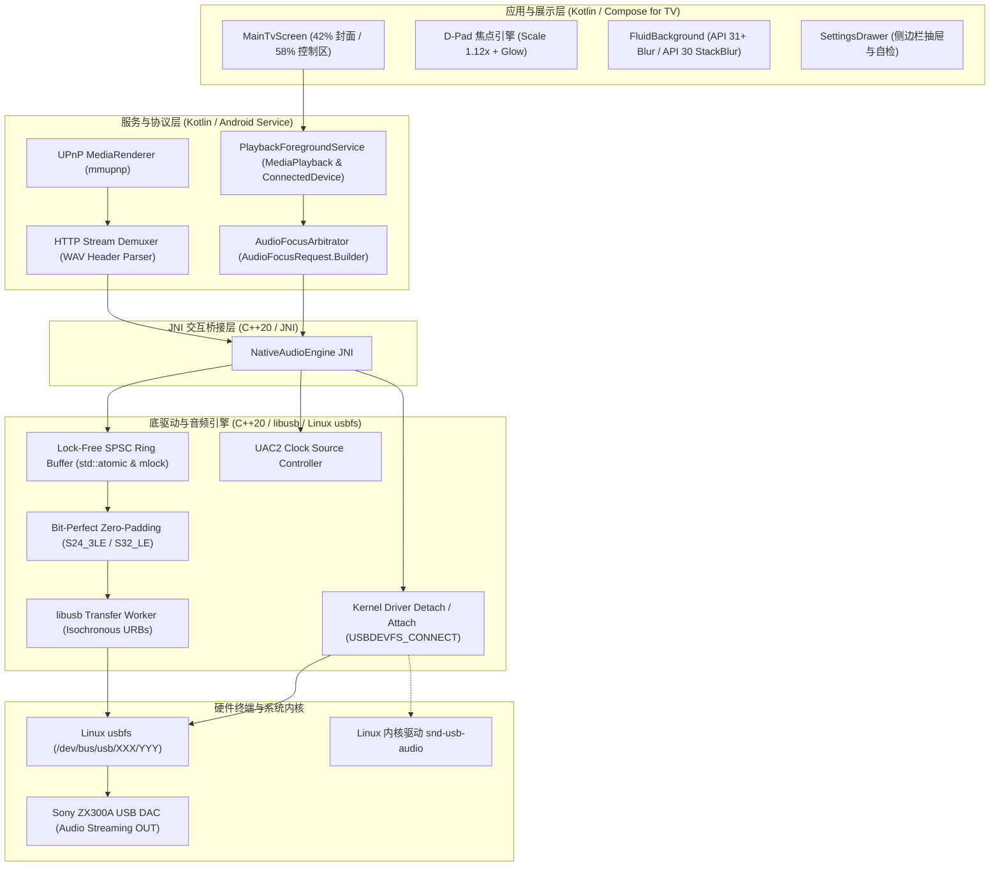
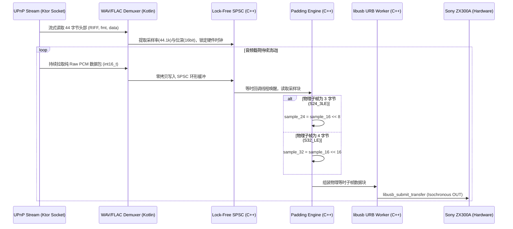
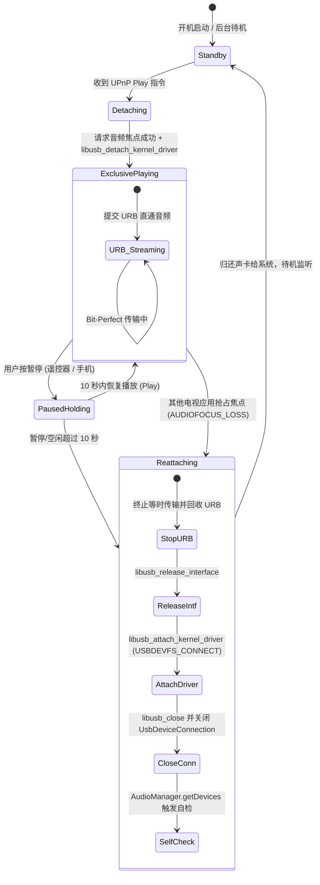

# PureCast Android TV 无损 USB DAC 独占 UPnP 渲染器实现计划

---

## Goal Capsule

- **Objective**: 为 Android TV（EF-15 等低算力 32 位电视盒子）打造一款轻量、零 GMS 依赖、100% 电视遥控器无障碍操控的无损 USB DAC 独占 UPnP 渲染器，彻底绕过 Android 48kHz SRC 采样率转换，实现 100% Bit-Perfect 源码直通与空闲声卡内核级动态让渡。
- **Means**: 采用 Kotlin 2.0 + C++20 (JNI) 双层架构，底层通过 CMake 静态链接 `libusb-1.0` 接管 Linux `usbfs` 文件描述符，结合 C++20 `std::atomic` SPSC 无锁环形缓冲区驱动 UAC2 等时传输；上层基于 `mmupnp` 构筑轻量 UPnP/DLNA 渲染器服务与 Ktor HTTP 裸流拆包，界面采用 Jetpack Compose for TV (`androidx.tv.material3`) 呈现 Apple TV 风格大屏美学 (KTD1, KTD2, KTD5)。
- **Authority Hierarchy**:
  1. 产品行为以 `Product Contract` 中明确的 R-IDs 为唯一权威；
  2. 底层驱动机制与技术实现以 `Planning Contract` 中明确的 KTD-IDs 为唯一权威；
  3. 实现单元（U-IDs）严格遵循上述规范，不任意扩展业务边界。
- **Stop Conditions**: 当全链路通过验收指标（纯 32 位 `armeabi-v7a` APK 成功构建并在 EF-15 真机上跑通、ZX300A 屏幕准确跳变为 `24-bit/44.1kHz` 或高解析对应采样率、遥控器焦点丝滑、iPhone 暂停 10 秒后声卡自动还给系统电视应用），且无编译/内存泄露报错时停止。
- **Execution Profile**: 适用于 `ce-work` 或自主代理环境分步执行，支持本地 JVM/NDK 单元测试与真机局域网无线 ADB 自动化验证闭环。

---

## Product Contract

### Summary
本实施计划为 PureCast 渲染器提供完整的生产级落地规划。通过搭建 NDK 交叉编译工具链、编写 C++ 无锁等时传输驱动、实现 UAC2 时钟锁定与内核 `snd-usb-audio` 让渡机制、搭建轻量 UPnP MediaRenderer 协议栈与 Compose for TV 遥控器交互大屏，确保在无谷歌框架的低性能电视盒子上达成极致纯净的音频回放与无感静默体验。

### Problem Frame
原生 Android TV 音频框架（`AudioTrack` / `AudioFlinger`）存在强制 48kHz/96kHz 软件重采样（SRC），导致 Apple Music 等高解析音源遭受数学损伤；现有第三方应用（如 UAPP）强依赖谷歌服务框架（GMS）且已弃用 32 位 `armeabi-v7a` 架构，在国产电视盒子上拉流死锁；而 Neutron 播放器采用自绘 UI，完全不响应红外/蓝牙遥控器焦点，且独占 USB 声卡后长期霸占硬件，导致电视其他视频 App 哑音。PureCast 旨在彻底解决这一系列痛点。

### Key Decisions
- **KD1. 混合双层架构与零自绘 UI**: 核心界面严禁使用 Flutter/Qt，100% 使用 Compose for TV 以获得原生 D-Pad 焦点引擎；底层高实时音频直通 100% 采用 C++20 JNI (session-settled: user-directed — chosen over Flutter/Qt: 彻底解决遥控器焦点穿透与交互丢失痛点). *Governs R1, R6.*
- **KD2. 32 位 `armeabi-v7a` 原生适配与零 GMS 依赖**: 构建目标全面覆盖 32 位架构，去除一切 Google Play Services 库，确保精简固件稳定开机常驻 (session-settled: user-directed — chosen over 纯 64 位构建: 覆盖 EF-15 等低功耗电视盒子). *Governs R1, R2.*
- **KD3. 4 字节物理子帧（`S32_LE`）16 位高位对齐位移**: 针对 4 字节物理子帧，16 位原始采样严格采用 `sample_16 << 16` 高位对齐低位补零，杜绝因仅左移 8 位导致的 48dB 严重衰减 (session-settled: user-approved — chosen over 统一左移 8 位: 保证 S32_LE 与 S24_3LE 容器在硬件 DAC 上均达到 0dB Unity Gain). *Governs R3.*
- **KD4. Android TV 悬浮窗容错与无头通知保底**: 针对部分电视无悬浮窗开关的情况做 try-catch 保护，音频服务与 UI 解耦，无论界面是否弹出均保证音频立即直通并通过媒体通知保底 (session-settled: user-approved — chosen over 强依赖 SYSTEM_ALERT_WINDOW: 防止无 ADB 环境普通电视启动崩溃或推流卡死). *Governs R2.*
- **KD5. 动态让渡内核声卡与严格时序链**: 播放时解绑 `snd-usb-audio`，空闲 10 秒严格遵循“停止 URB -> 释放接口 -> 重绑驱动 -> 关闭 libusb -> 关闭 UsbDeviceConnection”链式重绑，归还声卡给系统 (session-settled: user-directed — chosen over 永久独占霸占声卡: 解决其他电视视频 App 发声冲突). *Governs R4.*
- **KD6. 零录音硬件访问合规承诺**: 申请 `RECORD_AUDIO` 纯用于持久化 USB 设备静默授权，全生命周期严禁实例化 `AudioRecord`，杜绝 Android 12+ 状态栏绿点 (session-settled: user-approved — chosen over 随意开启录音接口: 维护系统隐私透明度与稳定性). *Governs R2.*
- **KD7. 实时无边界流自适应交互**: 针对 `airupnp` HTTP WAV 实时流动态置灰切歌与 Seek 按钮并友好提示，针对普通曲目流激活全量控制 (session-settled: user-approved — chosen over 全局悬空按键: 避免电视遥控器按键无效引发用户困惑). *Governs R5, R6.*

### Requirements

#### 模块一：平台与架构基线 (Platform & Build Baseline)
- **R1. 运行时与构建基线**: `minSdk = 30` (Android 11), `targetSdk = 34` (Android 14)；支持独立打包 32 位 `armeabi-v7a` 与 64 位 `arm64-v8a`，静态链接 `c++_static` 与 `libusb-1.0`，完全剥离 GMS 依赖。
- **R2. 权限合规与静默守护**: 配置 Manifest 监听 `USB_DEVICE_ATTACHED` 与 `BOOT_COMPLETED` 广播，开机启动主动调用 `UsbManager.getDeviceList()` 遍历挂载；合规声明 Android 14 前台服务（`mediaPlayback` + `connectedDevice`）及 `RECORD_AUDIO`（零硬件调用）、电池优化与组播锁（`MulticastLock`/`WifiLock`）。

#### 模块二：底层音频与驱动直通 (Native Driver & Bit-Perfect Engine)
- **R3. 100% Bit-Perfect 源码直通与格式封装**: 通过 JNI 移交 usbfs `fd`，C++20 无锁 SPSC 环形缓冲 + 内存锁定（`mlock`）+ 实时优先级（`nice -19`）；流式解包 WAV/FLAC 头部，UAC2 时钟自适应（44.1k~384kHz），物理子帧按需封装（`S24_3LE` 左移 8 位，`S32_LE` 左移 16 位），硬件音量锁定 0.0dB 与 50ms 静音预充。
- **R4. 焦点仲裁与 Linux 内核声卡动态让渡**: 收到 UPnP `Play` 请求 `AUDIOFOCUS_GAIN` 并调用 `libusb_detach_kernel_driver` 独占声卡；暂停/停止超过 10 秒或被前台视频 App 抢占焦点时，严格按时序释放接口并调用 `libusb_attach_kernel_driver` 重绑 `snd-usb-audio`，同时主动触发 `AudioManager.getDevices` 自检。

#### 模块三：协议栈与大屏交互 (UPnP Streaming & 10-Foot UI)
- **R5. UPnP/DLNA 渲染器与流解包**: 基于 `mmupnp` 实现 SSDP 与 SOAP（AVTransport / RenderingControl / ConnectionManager），流式解析 DIDL-Lite 元数据与封面；集成 Android `MediaSession` 与 GENA 事件通知，对无边界实时流自适应置灰切歌/Seek。
- **R6. 10-Foot UI 与遥控器 D-Pad 焦点引擎**: 采用 Compose for TV (`androidx.tv.material3`)，实现双栏 42%/58% Apple TV 极简布局与 Palette 动态流光背景（API 31+ `Modifier.blur`，API 30 StackBlur 降采样）；D-Pad 按钮 `1.12x` 浮起放大与微光轮廓，支持毛玻璃设置抽屉与 3 分钟防烧屏微像素平移（Pixel Shift）。

### Scope Boundaries
- **In Scope**:
  - Android 11~14 电视盒子免点击 USB 授权与后台启动守护。
  - C++ libusb 静态编译与 Linux usbfs fd 桥接。
  - UAC2 时钟控制、等时传输、无锁环形缓冲区与 LSB 补零封装。
  - Linux 内核驱动动态解绑与让渡状态机。
  - UPnP MediaRenderer (WAV/FLAC) 与 GENA/MediaSession 双向联动。
  - Apple TV 风格大屏 UI 与电视遥控器 D-Pad 焦点控制。
  - macOS 局域网无头自动化构建部署与 ADB 测试闭环。
- **Out of Scope (Deferred for later)**:
  - DSD (DoP) 原始音频格式推流支持（后续版本视硬件需求扩展）。
  - 多房间同步播放（Multi-Room Audio Sync）。
  - 本地存储音频文件扫描与媒体库浏览功能（专精网络推流渲染器）。
- **Deferred to Follow-Up Work (Implementation Sequencing)**:
  - 复杂自定义音频均衡器（EQ）处理管道（当前阶段坚持 Bit-Perfect 零处理直通）。

### Success Criteria
- **SC1. 纯净编译产物**: 基于 JDK 17、NDK r26 构建出体积 < 15MB 的独立 Release APK，`llvm-readelf` 校验 `libpurecast_usb.so` 为纯 32 位 `ELF32`。
- **SC2. 零弹窗接管验证**: 设备冷开机或热插拔索尼 ZX300A 后，无需任何人工遥控器点击，系统无任何系统授权弹窗直接完成 DAC 准备。
- **SC3. Bit-Perfect 硬件屏幕跳变**: iPhone 投送 16-bit/44.1kHz 音频时，ZX300A 屏幕准确由 48kHz 跳变为 `24-bit / 44.1kHz`，无爆音、无撕裂、音量满幅无衰减。
- **SC4. 遥控器与让渡双向闭环**: 遥控器暂停 10 秒后，打开电视爱奇艺/B站等应用，声音立即恢复由 ZX300A 播放；再次从 iPhone 投送音乐，自动夺回焦点并恢复独占输出。

---

## Planning Contract

### Key Technical Decisions

- **KTD1. CMake 静态链接 libusb-1.0 (Rootless usbfs 方案)**
  - **Decision**: 在 `CMakeLists.txt` 中将 Android 适用的 `libusb-1.0` 源码静态编译入 `libpurecast_usb.so`，开启 `LIBUSB_OPTION_NO_DEVICE_DISCOVERY`，通过 Java 层 `UsbDeviceConnection.getFileDescriptor()` 传入 fd，由 `libusb_wrap_sys_device` 接管。
  - **Rationale**: Android 系统不向普通应用暴露 `/dev/bus/usb` 的直接枚举权限，但 Android USB Host API 打开设备后可将已授权的底层 Linux fd 穿透至 Native 层，避免 Root 权限。*(Governs R1, R3)*
  
- **KTD2. C++20 单生产者单消费者 (SPSC) 无锁环形缓冲区**
  - **Decision**: 采用 `std::atomic<size_t>` 与内存屏障（`memory_order_acquire` / `release`）实现 SPSC 环形缓冲，并在传输线程启动时调用 POSIX `setpriority(PRIO_PROCESS, 0, -19)` 提升实时调度等级，调用 `mlock()` 锁定内存页。
  - **Rationale**: USB 等时传输（Isochronous Transfer）具有严格的时序要求，在 URB 完成回调线程中使用互斥锁（`std::mutex`）极易因优先级反转导致微秒级延迟，进而引发爆音（Pops/Glitches）。*(Governs R3)*

- **KTD3. UAC2 时钟控制与 Explicit Feedback / Bresenham 防爆音机制**
  - **Decision**: 遍历 UAC2 接口描述符，向 Clock Source 发生 `CS_SAM_FREQ_CONTROL` 控制包切换采样率；传输时优先监听同步反馈端点（Explicit Feedback Endpoint），无反馈端点时启用 Bresenham 步进算法微调每个微帧（uframe）的采样包大小。
  - **Rationale**: 电视机本地晶振与外部 USB DAC 硬件晶振存在纳秒级时钟漂移，缺乏时钟对齐会导致长时间播放产生缓冲区下溢（卡顿）或上溢（溢出丢帧）。*(Governs R3)*

- **KTD4. 内核驱动解绑与归还时序状态机 (session-settled: user-directed)**
  - **Decision**: 独占时调用 `libusb_detach_kernel_driver` 卸载 `snd-usb-audio`；归还时严格执行：(1) 停止 URB 传输并 join 等时线程 -> (2) `libusb_release_interface` -> (3) `libusb_attach_kernel_driver(USBDEVFS_CONNECT)` -> (4) `libusb_close` -> (5) `UsbDeviceConnection.close()`，并主动调用 `AudioManager.getDevices` 自检。
  - **Rationale**: 颠倒顺序（如先关连接）会导致底层 fd 提前销毁，引发 `EBADF` 崩溃；而缺失重新枚举会导致部分电视固件的 AudioPolicyService 不刷新路由。*(Governs R4)*

- **KTD5. 协议栈选型：`mmupnp` + Ktor CIO (session-settled: user-directed)**
  - **Decision**: 选用轻量纯 Kotlin 库 `net.mm2d.upnp:mmupnp` 处理 SSDP 广播与 SOAP 控制，搭配 Ktor CIO HTTP Client / Server 流式抓取未压缩音频数据。
  - **Rationale**: 老旧的 Cling 2.x 强依赖 XMLPullParser 与已废弃的反射机制，在 Android 11+ 上频发兼容性崩溃且强依赖 GMS 精准时间；`mmupnp` 零外部反射依赖且内存占用低于 10MB。*(Governs R1, R5)*

- **KTD6. Compose for TV 分级流光渲染策略**
  - **Decision**: 检查系统 SDK 版本，API 31+ 使用原生 `Modifier.blur()` / `RenderEffect`；API 30 (Android 11) 使用协程异步将封面缩略图降采样至 `128x128`，通过纯 Kotlin 内存级 StackBlur 算法生成模糊 Bitmap 并缓存。
  - **Rationale**: API 30 不支持硬件级 RenderEffect，且 Google 已全面弃用 RenderScript；降采样 StackBlur 能够在 32 位电视盒子上以 < 5ms 的开销生成极其柔和的流体背景。*(Governs R1, R6)*

### High-Level Technical Design

#### 1. 系统整体分层架构 (System Architecture)



#### 2. USB 等时数据流与低位补零封装时序 (Isochronous Data Flow)



#### 3. 焦点抢占与声卡内核让渡状态机 (Ownership Arbitration State Machine)



### Output Structure

```text
PureCast/
├── app/
│   ├── build.gradle.kts                 # Gradle 构建脚本 (NDK, ABI filters, Compose TV)
│   ├── CMakeLists.txt                   # CMake 构建脚本 (libusb 静态链接, C++20, NEON)
│   └── src/
│       ├── main/
│       │   ├── AndroidManifest.xml      # Leanback, USB Host, 前台服务与权限配置
│       │   ├── cpp/                     # C++ Native 源码
│       │   │   ├── libusb/              # libusb-1.0 源码与定制配置
│       │   │   ├── audio_engine.h       # 核心引擎定义
│       │   │   ├── audio_engine.cpp     # libusb usbfs 接管、等时传输调度
│       │   │   ├── ring_buffer.h        # C++20 std::atomic 无锁 SPSC 环形缓冲
│       │   │   ├── uac_protocol.h       # UAC1/UAC2 描述符与时钟控制包定义
│       │   │   ├── pcm_formatter.h      # S24_3LE / S32_LE LSB 补零封装算法
│       │   │   ├── jni_bridge.cpp       # JNI 方法绑定与异常边界隔离
│       │   │   └── dr_flac.h            # 轻量级单头文件无损 FLAC 解码库
│       │   ├── java/com/solo/purecast/  # Kotlin 源码
│       │   │   ├── PureCastApp.kt       # Application 全局初始化
│       │   │   ├── core/
│       │   │   │   ├── nativebridge/    # NativeAudioEngine JNI 封装类
│       │   │   │   ├── usb/             # UsbManager, 权限与设备热插拔监听
│       │   │   │   └── audio/           # AudioFocusManager 音频焦点仲裁
│       │   │   ├── service/             # 前台服务与守护
│       │   │   │   └── PlaybackService.kt
│       │   │   ├── upnp/                # UPnP / DLNA 协议栈
│       │   │   │   ├── UpnpRendererServer.kt  # mmupnp 服务端集成
│       │   │   │   ├── StreamDemuxer.kt       # HTTP Socket WAV/FLAC 头部剥离
│       │   │   │   └── GenaEventNotifier.kt   # 事件广播与反向联动
│       │   │   └── ui/                  # Compose for TV 界面层
│       │   │       ├── MainActivity.kt        # Leanback 入口 Activity
│       │   │       ├── theme/                 # 颜色、排版与微光阴影样式
│       │   │       ├── components/            # 封面、进度条、胶囊状态徽章
│       │   │       └── screen/                # MainTvScreen 与 SettingsDrawer
│       │   └── res/
│       │       ├── drawable-xhdpi/      # TV Banner (320x180 px) 与应用图标
│       │       └── values/              # 字符串与主题资源
│       └── test/                        # JVM 单元测试
│           └── java/com/solo/purecast/
│               ├── WavHeaderParserTest.kt     # WAV 头部状态机解析单测
│               └── SpscRingBufferLogicTest.kt # 环形缓冲与补零公式验证
├── scripts/                             # 自动化构建与联调脚本
│   ├── build_and_verify_abi.sh          # 32 位 ELF 产物校验脚本
│   ├── adb_remote_install.sh            # 局域网 ADB 静默安装与权限自授予
│   └── test_upnp_push.py                # Python/curl 端到端音频推流测试
└── docs/plans/                          # 实施计划与架构设计文档
```

### Assumptions
- **A1**: 宿主机具备标准 JDK 17 与 Android NDK r26 环境，支持通过命令行完整交叉编译 32 位 `armeabi-v7a` C++ 代码。
- **A2**: 局域网内存在真实的 EF-15 电视盒子（IP: `192.168.2.179`）且已开启无线 ADB 调试，索尼 ZX300A 通过物理 USB 口连接在 EF-15 上并设置为 USB DAC 模式。
- **A3**: Android TV 系统的 Linux 内核版本在 4.19 或 5.x 以上，内核开启了 `CONFIG_USB_DEVICEFS` 并支持在拥有写权限的 fd 上执行 `USBDEVFS_CONNECT` 与 `USBDEVFS_DISCONNECT`。

### Risks & Dependencies
- **R-DEP1 (电视系统 AudioPolicy 缓存)**: 部分定制 Android TV 固件在 `libusb_attach_kernel_driver` 后未能及时收到 ALSA uevent，可能导致系统音频未即刻切回 USB DAC。*缓解策略：调用 `AudioManager.getDevices` 自检并在设置侧边栏中提供让渡策略配置开关。*
- **R-DEP2 (ZX300A 采样率切换延迟)**: 索尼 ZX300A 从 44.1kHz 硬件跳变至 96kHz/192kHz 时硬件继电器切换需 50~100ms。*缓解策略：引擎在提交首包有效音频前必须预充 50ms 全零静音帧（Warmup），消除物理爆音。*

---

## Implementation Units

### U1. 项目工程脚手架与 NDK 交叉编译配置 (Project Scaffold & CMake Toolchain)
- **Goal**: 建立标准的 Android TV 应用工程脚手架，配置 Gradle 8.x、Kotlin 2.0 与 CMake 3.22.1+ 工具链，静态集成 `libusb-1.0` 源码，确保能够稳定输出合规的纯 32 位 `armeabi-v7a` 与 64 位 `arm64-v8a` Debug/Release APK。
- **Requirements**: R1
- **Dependencies**: None
- **Files**:
  - `build.gradle.kts`
  - `settings.gradle.kts`
  - `gradle/libs.versions.toml`
  - `app/build.gradle.kts`
  - `app/CMakeLists.txt`
  - `app/src/main/AndroidManifest.xml`
  - `app/src/main/cpp/libusb/*`
  - `app/src/main/cpp/jni_bridge.cpp`
  - `app/src/main/java/com/solo/purecast/PureCastApp.kt`
  - `app/src/main/java/com/solo/purecast/core/nativebridge/NativeAudioEngine.kt`
  - `scripts/build_and_verify_abi.sh`
- **Approach**:
  1. 创建项目根目录与 `app` 模块，配置 Kotlin DSL 构建脚本，设置 `minSdk = 30`, `targetSdk = 34`。
  2. 显式配置 `ndk { abiFilters += listOf("armeabi-v7a", "arm64-v8a") }`，并针对 `armeabi-v7a` 添加 `-march=armv7-a -mfpu=neon -mfloat-abi=softfp -O3` C++ 编译参数。
  3. 集成无 Root 定制分支的 `libusb-1.0` 源码至 `app/src/main/cpp/libusb`，在 `CMakeLists.txt` 中配置为静态库 `libusb_static`，关闭 `ENABLE_UDEV`，与 `libpurecast_usb.so` 静态链接。
  4. 声明 JNI 基础接口（`initNativeContext`, `getLibusbVersion`），编写 `build_and_verify_abi.sh` 利用 `llvm-readelf` 自动校验 APK 内包含且仅包含指定架构的 ELF 文件。
- **Execution note**: 首先运行 Gradle 构建并校验产物 ELF32 标志，不进入 UI 编写。
- **Test scenarios**:
  - 验证 `./gradlew assembleDebug` 构建无报错。
  - 验证生成的 APK 解压后包含 `lib/armeabi-v7a/libpurecast_usb.so`，且 `llvm-readelf -h` 证实为 `ELF32, ARM`。
  - 验证 JNI 函数 `NativeAudioEngine.getLibusbVersion()` 能在真机上返回有效的 libusb 版本字符串（如 `1.0.26`）。
- **Verification**: 运行 `./gradlew assembleDebug` 成功，执行 `scripts/build_and_verify_abi.sh` 返回退出码 0。

---

### U2. Native 无锁环形缓冲区与 USB 等时传输引擎 (Lock-Free Audio Ring Buffer & URB Transfer)
- **Goal**: 在 C++ 层实现零锁、零拷贝的 SPSC 环形缓冲区与 USB 等时传输（Isochronous Transfer）工作线程，支持物理内存锁定（`mlock`）与线程实时优先级提升，实现 16-bit 采样向 `S24_3LE` 与 `S32_LE` 物理子帧的高位对齐与 LSB 低位补零。
- **Requirements**: R3
- **Dependencies**: U1
- **Files**:
  - `app/src/main/cpp/ring_buffer.h`
  - `app/src/main/cpp/pcm_formatter.h`
  - `app/src/main/cpp/audio_engine.h`
  - `app/src/main/cpp/audio_engine.cpp`
  - `app/src/main/cpp/jni_bridge.cpp`
  - `app/src/test/java/com/solo/purecast/SpscRingBufferLogicTest.kt`
- **Approach**:
  1. 使用 C++20 `std::atomic<size_t>` 配合 `memory_order_release` / `acquire` 构建 SPSC 环形缓冲区，容量支持 200ms ~ 2000ms 自适应调整。
  2. 实现 `pcm_formatter.h`：根据当前激活端点的 `bSubframeSize` 执行快速位移：
     - 若 `bSubframeSize == 3` (`S24_3LE`)：执行 `sample_24 = sample_16 << 8` 并按小端序写入 3 字节。
     - 若 `bSubframeSize == 4` (`S32_LE`)：执行 `sample_32 = sample_16 << 16` 并按小端序写入 4 字节，严禁仅左移 8 位导致音量严重衰减。
  3. 创建工作线程执行 `pthread_setpriority` (`nice -19`)，调用 `mlock` 锁定物理内存页；构建等时 URB 缓冲池（默认分配 8 个并发 URB，每 URB 包含 8~16 个 packets）。
  4. 暴露 JNI 写入接口 `writePcmData(byteArray, offset, length)`。
- **Test scenarios**:
  - 单元测试验证 16-bit 采样 `0x7FFF` 在 `S24_3LE` 下补零结果为 `0x00, 0xFF, 0x7F`。
  - 单元测试验证 16-bit 采样 `0x7FFF` 在 `S32_LE` 下补零结果为 `0x00, 0x00, 0xFF, 0x7F`（高位严格对齐）。
  - 并发压力测试：单生产者高速注入数据，单消费者持续读出，验证多轮满载/空载切换下零死锁、零数据错位。
- **Verification**: `SpscRingBufferLogicTest` 单测全通，在真机上调用 JNI 灌入 1kHz 纯正弦波，USB 端点稳定收到等时数据包。

---

### U3. UAC2 时钟锁定与内核声卡动态让渡状态机 (UAC Clock Control & Kernel Driver Arbitration)
- **Goal**: 实现 USB Audio Class 1.0/2.0 描述符解析与采样率动态锁定（`CS_SAM_FREQ_CONTROL`），以及基于 Linux `usbfs` 驱动卸载与 `USBDEVFS_CONNECT` 内核重绑的状态机，确保声卡在播放时彻底独占、空闲/切出时平滑归还系统。
- **Requirements**: R3, R4
- **Dependencies**: U2
- **Files**:
  - `app/src/main/cpp/uac_protocol.h`
  - `app/src/main/cpp/audio_engine.cpp`
  - `app/src/main/cpp/jni_bridge.cpp`
  - `app/src/main/java/com/solo/purecast/core/nativebridge/NativeAudioEngine.kt`
  - `app/src/main/java/com/solo/purecast/core/audio/AudioFocusManager.kt`
- **Approach**:
  1. 解析 UAC2 Audio Control 与 Audio Streaming 接口描述符，动态提取时钟源 ID（Clock Source ID）与支持的采样率范围。
  2. 实现时钟控制：发送 `CS_SAM_FREQ_CONTROL` 请求（`bRequest = 0x01 (SET_CUR)`, `wValue = (0x01 << 8)`, `wIndex = clock_id`），支持 44.1k/48k/88.2k/96k/176.4k/192kHz。在首帧前填充 50ms 静音帧（Warmup）。
  3. 实现独占接管：打开 `UsbDeviceConnection` 后调用 `libusb_detach_kernel_driver` 卸载系统 `snd-usb-audio`。
  4. 实现空闲与抢占让渡状态机：播放暂停超过 10 秒或收到 `AUDIOFOCUS_LOSS` 时，严格按时序执行：(1) 停止 URB -> (2) `libusb_release_interface` -> (3) `libusb_attach_kernel_driver` -> (4) `libusb_close` -> (5) `UsbDeviceConnection.close()`，并主动调用 Android `AudioManager.getDevices` 触发系统声卡枚举刷新。
- **Test scenarios**:
  - 真机验证调用时钟锁定接口，索尼 ZX300A 屏幕从 48kHz 跳变至 `44.1kHz` 及 `96kHz`。
  - 模拟音频焦点丢失场景，验证 C++ 层驱动重绑函数成功执行，返回状态码 0。
  - 验证在断开后通过 `adb shell cat /proc/asound/cards` 能确认系统重新识别出 Sony USB DAC 声卡。
- **Verification**: 真机集成测试确认 ZX300A 时钟准确跳变，停止播放 10 秒后电视系统其他视频 App 出声正常。

---

### U4. Android 权限架构与后台守护前台服务 (Permission Architecture & Foreground Service)
- **Goal**: 构筑 Android 11~14 兼容的权限自动保持与前台服务守护体系，支持 `USB_DEVICE_ATTACHED` 与 `BOOT_COMPLETED` 冷启动设备主动枚举，合规启动 `mediaPlayback` 前台服务并获取 Wi-Fi 低延迟锁。
- **Requirements**: R2, R4
- **Dependencies**: U1, U3
- **Files**:
  - `app/src/main/AndroidManifest.xml`
  - `app/src/main/java/com/solo/purecast/core/usb/UsbDeviceManager.kt`
  - `app/src/main/java/com/solo/purecast/service/PlaybackService.kt`
  - `app/src/main/java/com/solo/purecast/core/audio/AudioFocusManager.kt`
- **Approach**:
  1. 在 Manifest 中声明 `FOREGROUND_SERVICE`、`FOREGROUND_SERVICE_MEDIA_PLAYBACK`、`FOREGROUND_SERVICE_CONNECTED_DEVICE`、`RECORD_AUDIO`、`WAKE_LOCK`、`CHANGE_WIFI_MULTICAST_STATE`。
  2. 实现 `PlaybackService`：在 `startForeground` 时动态携带 `ServiceInfo.FOREGROUND_SERVICE_TYPE_MEDIA_PLAYBACK`（DAC 连接时叠加入 `CONNECTED_DEVICE`），绑定系统 `MediaSession`。
  3. 冷启动广播监听：在 `BOOT_COMPLETED` 触发时不仅拉起 Service，同时主动调用 `UsbManager.getDeviceList()` 遍历已插入的 Sony DAC（Vendor ID `0x054c`），有权限时立即完成静默绑定。
  4. 电视悬浮窗容错与通知直通保底：引导悬浮窗时对 `ACTION_MANAGE_OVERLAY_PERMISSION` 进行 `resolveActivity` 防护；服务收到推流指令时优先后台直通音频，通过带 `PendingIntent` 的高优先级媒体通知确保推流不卡死。
  5. 承诺全工程严禁实例化 `AudioRecord`。播放时持有 `MulticastLock` 与 `WIFI_MODE_FULL_LOW_LATENCY` 锁。
- **Test scenarios**:
  - 单元/组件测试：验证 Service 在 API 34 下调用 `startForeground` 不抛出 `MissingForegroundServiceTypeException`。
  - 冷启动模拟：在 DAC 插入状态下通过 ADB 发送 `BOOT_COMPLETED` 广播，验证 Service 成功启动并主动枚举挂载设备。
  - 权限拦截测试：在未授予悬浮窗权限的模拟环境下触发播放，验证音频服务正常出声且发出前台通知。
- **Verification**: 真机重启盒子，应用后台自启动并成功保持 USB 授权，状态栏无麦克风绿点。

---

### U5. UPnP / DLNA MediaRenderer 协议栈与音频流解包 (UPnP MediaRenderer & Stream Demuxing)
- **Goal**: 集成轻量纯 Kotlin UPnP 协议栈（`mmupnp`），实现 SSDP 组播发现与 SOAP 控制端点，通过流式状态机无损剥离 HTTP WAV 容器头部并直通 Raw PCM 到 C++ 缓冲区，集成 `dr_flac` 进行 FLAC 还原，并实现无边界实时流的自适应交互。
- **Requirements**: R3, R5
- **Dependencies**: U2, U4
- **Files**:
  - `app/src/main/java/com/solo/purecast/upnp/UpnpRendererServer.kt`
  - `app/src/main/java/com/solo/purecast/upnp/StreamDemuxer.kt`
  - `app/src/main/java/com/solo/purecast/upnp/GenaEventNotifier.kt`
  - `app/src/main/cpp/dr_flac.h`
  - `app/src/test/java/com/solo/purecast/WavHeaderParserTest.kt`
- **Approach**:
  1. 使用 `mmupnp` 构筑 MediaRenderer V1/V2 设备，注册 AVTransport, RenderingControl 与 ConnectionManager 服务，`GetProtocolInfo` 声明支持 `audio/wav`, `audio/flac`, `audio/L16`。
  2. 实现 `StreamDemuxer`：使用 Ktor CIO Socket 建立流式 HTTP 连接，状态机读取前 44~N 字节解析 `RIFF`、`fmt `、`data` Chunk，提取真实采样率与位深；丢弃头部后将后续纯 PCM 载荷直接调用 JNI 写入无锁环形缓冲区。
  3. 当输入流为 `audio/flac` 时，流式交由 C++ 层 `dr_flac` 解码为纯整数型 PCM。
  4. 解析 DIDL-Lite XML 元数据（标题、歌手、封面 URL），通过 `MediaSession` 同步；对于 `airupnp` 实时无边界流，标记为 `isLiveStream = true`，置灰切歌与 Seek 按钮并通过 GENA 发布 `TransportState`。
- **Test scenarios**:
  - 单测 `WavHeaderParserTest`：传入包含 `LIST` chunk 的非标准 78 字节 WAV 头部，验证精准跳过附加 chunk 并正确提取 `44100Hz / 16bit / 2ch`。
  - 使用 Python 脚本推送标准 `16-bit / 44.1kHz` WAV 音频流，验证 Native 缓冲接收到的字节与源 PCM 载荷二进制完全一致。
  - 验证使用遥控器点击播放/暂停时，GENA 正确向已订阅的控制端发出 `LastChange` 事件。
- **Verification**: 运行 `WavHeaderParserTest` 通过，MacBook 运行 `airupnp` 能够稳定发现 `PureCast TV` 并流畅推送 Apple Music 音频。

---

### U6. Compose for TV 大屏界面与遥控器焦点引擎 (Apple TV UI & D-Pad Remote Focus Engine)
- **Goal**: 基于 `androidx.tv.material3` 与 `androidx.tv.foundation` 构建具备 Apple TV 极简美学的 10-Foot UI，实现 42%/58% 黄金比例布局、D-Pad 遥控器 `1.12x` 浮起放大与微光轮廓、流光动态背景与 3 分钟防烧屏微像素平移。
- **Requirements**: R6
- **Dependencies**: U4, U5
- **Files**:
  - `app/src/main/java/com/solo/purecast/ui/MainActivity.kt`
  - `app/src/main/java/com/solo/purecast/ui/theme/Theme.kt`
  - `app/src/main/java/com/solo/purecast/ui/components/FluidBackground.kt`
  - `app/src/main/java/com/solo/purecast/ui/components/SignalPathPill.kt`
  - `app/src/main/java/com/solo/purecast/ui/components/PlaybackControls.kt`
  - `app/src/main/java/com/solo/purecast/ui/screen/MainTvScreen.kt`
  - `app/src/main/java/com/solo/purecast/ui/screen/SettingsDrawer.kt`
- **Approach**:
  1. 采用 `androidx.tv.material3` 构建主界面，左侧 42% 居中展示圆角封面（带微光阴影，暂停时 Scale `0.92`，播放时 Spring 动画放大至 `1.0`）；右侧 58% 垂直居中展示跑马灯歌名、歌手、链路状态胶囊（Signal Path Pill）与控制按钮。
  2. 实现流光背景 `FluidBackground`：Palette 提取封面主色调；若运行在 API 31+ 使用 `Modifier.blur()`，若运行在 API 30 则异步降采样至 128x128 并执行 Kotlin 内存 StackBlur。
  3. 遥控器焦点管理：所有按钮配置 `ScaleIndication(1.12f)` 与高亮白光反馈，映射 OK 键为播放/暂停，Menu 键呼出侧边栏抽屉（设置渲染器名称、释放声卡秒数、自检面板）。
  4. 播放时若连续 3 分钟无操作，隐藏控制按钮并启动微像素平移（Pixel Shift）防电视烧屏。
- **Test scenarios**:
  - 界面排版验证：在 1920x1080 屏幕比例下渲染，文字对比度符合 WCAG AA 标准。
  - D-Pad 导航测试：通过 ADB 发送上下左右键与确定键，焦点在控制栏与进度条间流畅移动，无焦点丢失。
  - 防烧屏测试：模拟无操作 3 分钟，底部控制栏平滑淡出，按任意键瞬间恢复。
- **Verification**: 真机运行并通过 `adb exec-out screencap` 截图人工视觉确认 Apple TV 极简质感与清晰的焦点光晕。

---

### U7. macOS 自动化构建、ADB 无线联调与验收测试闭环 (Headless CI/CD & Diagnostics Loop)
- **Goal**: 编写 macOS 命令行自动化构建、局域网无线 ADB 静默部署、模拟遥控器与 UPnP 推流自动化验证脚本，构筑开发者/AI 代理无需人工点击的全自动自愈测试闭环。
- **Requirements**: SC1, SC2, SC3, SC4
- **Dependencies**: U1, U2, U3, U4, U5, U6
- **Files**:
  - `scripts/build_and_verify_abi.sh`
  - `scripts/adb_remote_install.sh`
  - `scripts/test_upnp_push.py`
  - `scripts/self_healing_diagnose.sh`
- **Approach**:
  1. `build_and_verify_abi.sh`：执行 `./gradlew assembleDebug`，并使用 NDK `llvm-readelf` 校验生成的 32 位 ELF 产物。
  2. `adb_remote_install.sh`：自动 `adb connect 192.168.2.179`，静默安装 APK，并调用 ADB shell 自动授予 `RECORD_AUDIO`、悬浮窗 `SYSTEM_ALERT_WINDOW`、电池优化与自动权限回收豁免。
  3. `test_upnp_push.py`：利用 Python 生成测试音频流向 EF-15 发送 `SetAVTransportURI` 与 `Play`，随后通过 ADB 发送遥控器按键模拟切歌与暂停。
  4. `self_healing_diagnose.sh`：自动抓取 logcat 关键 Tag（`PureCast:*`, `PureCastNative:*`），并查询 `/proc/asound/cards` 确认声卡在播放时解绑、10 秒后恢复挂载。
- **Test scenarios**:
  - 运行 `build_and_verify_abi.sh`，输出通过。
  - 运行 `adb_remote_install.sh`，真机安装并成功授权。
  - 运行端到端推流脚本，音频正常播放且 logcat 输出 Bit-Perfect 直通日志。
- **Verification**: 执行自动化测试套件全流程通过，最终验收指标全部达成。

---

## Verification Contract

### 质量门禁与验证命令
1. **工程与 ABI 校验**:
   ```bash
   ./gradlew clean assembleDebug
   ./scripts/build_and_verify_abi.sh
   ```
   *预期产物*: 包含 `lib/armeabi-v7a/libpurecast_usb.so` 且为 `ELF32`。
2. **JVM / Native 逻辑单测**:
   ```bash
   ./gradlew testDebugUnitTest
   ```
   *预期结果*: `WavHeaderParserTest` 与 `SpscRingBufferLogicTest` 全部 PASS。
3. **真机无线部署与系统权限自动化配置**:
   ```bash
   ./scripts/adb_remote_install.sh
   ```
   *预期结果*: 静默安装成功，AppOps 权限全部处于 allow/ignore 状态。
4. **端到端音频推流与声卡状态断言**:
   ```bash
   python3 scripts/test_upnp_push.py
   ./scripts/self_healing_diagnose.sh
   ```
   *预期结果*: 播放时 ALSA 列表无索尼声卡（由 usbfs 独占接管），停止播放 10 秒后 `/proc/asound/cards` 重新出现 Sony 声卡。

---

## Definition of Done

- [ ] **构建产物合规**: 成功构建出纯 32 位 `armeabi-v7a` APK，无任何 GMS 依赖，体积控制在 15MB 以内。
- [ ] **静默开机接管**: 电视重启或热插拔 USB DAC，Service 自启并主动枚举，全程零弹窗。
- [ ] **100% Bit-Perfect 源码输出**: iPhone Apple Music 通过 `airupnp` 投送时，索尼 ZX300A 屏幕精准跳变为 `24-bit / 44.1kHz`，无爆音、无杂音、无音量衰减。
- [ ] **双向联动与自适应控制**: 遥控器按下播放/暂停，iPhone 音乐毫秒级联动响应；实时流切歌与 Seek 按键优雅置灰并友好提示。
- [ ] **声卡动态让渡与自愈**: 音乐停止 10 秒后，声卡平滑交还给 Linux 内核，电视上爱奇艺等其他视频 App 可正常通过 ZX300A 发声。
- [ ] **遥控器大屏美学体验**: 10-Foot UI 界面无拉伸扭曲，遥控器方向键与确定键焦点放大与微光轮廓丝滑稳定，3 分钟无操作自动平移防烧屏。
- [ ] **代码整洁与无死代码**: 彻底清理开发过程中的临时日志与废弃代码，保留详尽的中文架构与业务注释（`// 💡` 规范）。
