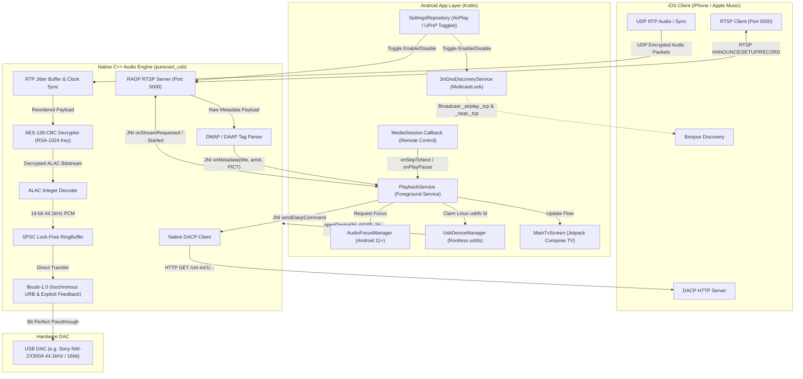
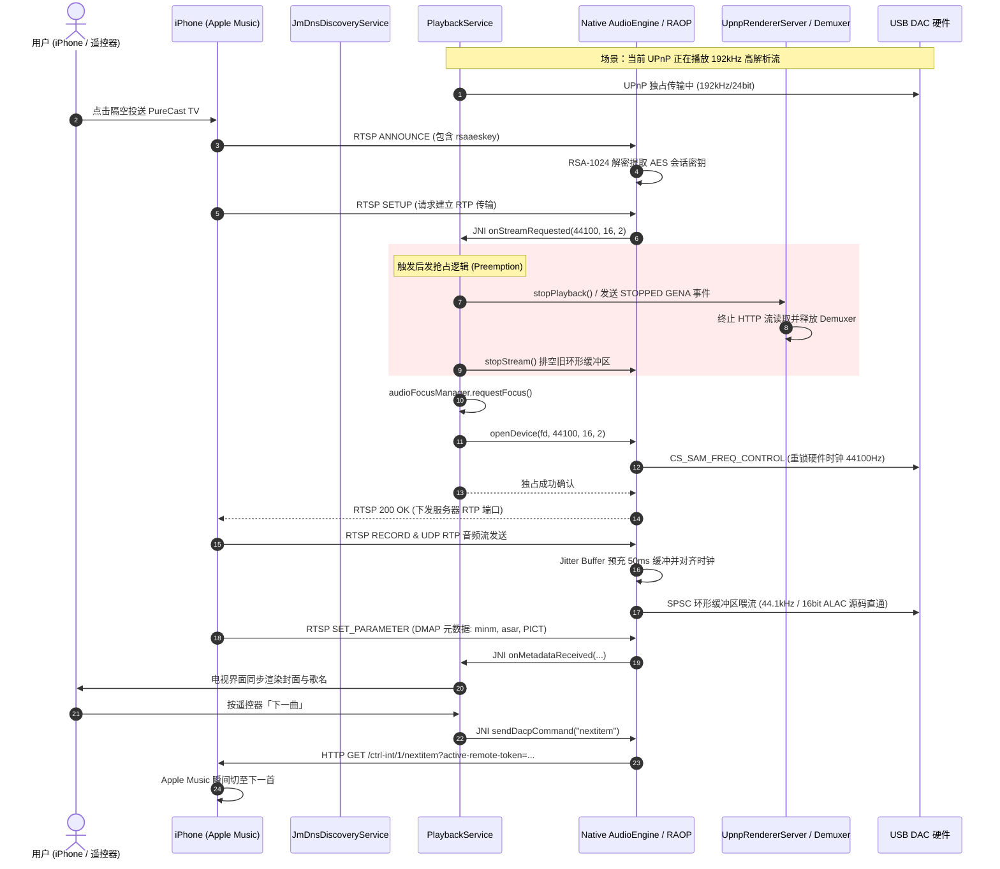

## Goal Capsule

- **Objective**: 电视端 PureCast 具备原生 AirPlay 1 (RAOP / AirTunes) 无损音频直通接收能力，使用户可在无 MacBook `airupnp` 桥接的情况下，直接从 iPhone / iPad 隔空投送 16-bit / 44.1kHz ALAC 源码至电视并经由 libusb 独占直通 USB DAC，同时支持双向元数据同步与遥控器原生 DACP 反控。
- **Means**: 在 Native C++ 层内嵌轻量级 RAOP 协议栈（RTSP 会话状态机 + AES-128 解密 + ALAC 整数解码 + RTP Jitter Buffer 漂移补偿），配合 Kotlin 层 `jmdns` 双服务 Bonjour 广播与 `PlaybackService` 双引擎后发抢占仲裁。(KTD1, KTD2, KTD3, KTD4, KTD5)
- **Authority Hierarchy**:
  1. 用户与 Android TV 操作系统约束：确保 USB DAC 独占直通彻底绕过 Android 48kHz SRC；严守 Android 11+ 音频焦点与前台服务权限准则。
  2. Product Contract（AirPlay 1 无损直通与免外部桥接交付标准）。
  3. Planning Contract & Implementation Units（工程落地与架构实现）。
- **Stop Conditions**:
  - iPhone 控制中心与 Apple Music 隔空投送列表能稳定搜索到 PureCast TV。
  - iPhone 直连隔空投送时，C++ Native 层实时解密并 ALAC 解码 44.1kHz/16bit PCM 注入 libusb 环形缓冲区直通 USB DAC，且连续播放无 Overrun / Underrun 爆音断流。
  - 电视遥控器按键能够通过 DACP 实时反向控制 iPhone 播放、暂停与切歌。
  - AirPlay 与 UPnP 双引擎并发时稳定执行后发抢占与优雅切换，空闲 10 秒后正常归还 USB DAC 驱动给 Android 系统。
- **Execution Profile**: `code`

---

## Product Contract

*(see origin: `内置原生 AirPlay 1 (AirTunes  RAOP) 无损直通接收引擎（免 MacBook 桥接）requirements-only.md`)*

### Summary
在保留 UPnPMediaRenderer（用于接收 96kHz~192kHz 超高解析流）的基础上，在 Native C++ 层直接集成 AirPlay (RAOP / AirTunes) 接收端协议栈，使 iPhone 可在无 MacBook `airupnp` 桥接的情况下，直接隔空投送 16-bit / 44.1kHz ALAC 无损音频并直通 libusb 独占 USB DAC 通道。同时通过 `jmdns` 广播双 Bonjour 服务确保 iOS 15~18 稳定发现，通过 DMAP/DACP 实现元数据与遥控器双向联动，并通过后发抢占机制解决双协议硬件并发冲突。

### Problem Frame
在当前架构中，iPhone 隔空投送依赖运行在 MacBook 上的 `airupnp` 桥接进程将 AirPlay 流转封装为 UPnP HTTP 流推给电视端 PureCast。这要求用户必须同时开启电脑并处于同一局域网，一旦电脑休眠或断网即导致音乐中断，使用门槛高且割裂。通过在电视端直接内置原生 AirPlay 1 协议栈，实现免电脑桥接的独立直连接收与源码直通。

### Key Decisions
- **KD1: 采用后发抢占优先模式（Preemption）** `(session-settled: user-directed — chosen over '先发锁定拒绝新连接': 保证客厅场景下新发推流即刻响应，向旧协议发送停止/暂停通知并重新配置声卡)` — *Governs R5*
- **KD2: 选型轻量级 `jmdns` 广播 `_airplay._tcp` 与 `_raop._tcp` 双服务** `(session-settled: user-approved — chosen over 'Android 原生 NsdManager': 规避 Android TV 上 NsdManager 实例名包含 @ 字符时的崩溃及 TXT 记录截断 Bug)` — *Governs R1*
- **KD3: Native 层补充 RTP Jitter Buffer 与硬件时钟漂移补偿** `(session-settled: user-approved — chosen over '裸 PCM 直接灌入环形缓冲区': 消除 iPhone UDP 发送时钟与 UAC2 Explicit Feedback DAC 物理晶振频差，彻底杜绝 Overrun/Underrun 爆音)` — *Governs R2*
- **KD4: Native RAOP 握手阶段通过 JNI 唤醒 `PlaybackService` 获取系统音频焦点与 USB 独占句柄** `(session-settled: user-approved — chosen over 'Native 单方面直通': 严守 Android 11+ 焦点与权限时序，防范被系统静音或杀进程)` — *Governs R2, R4*
- **KD5: 遥控器多媒体按键由 `PlaybackService` 的 `MediaSession.Callback` 统一捕获并分发 HTTP DACP 控制指令** `(session-settled: user-approved — chosen over '独立按键监听': 兼容 Android TV 全局媒体键并实现与 iPhone Apple Music 零延迟双向同步)` — *Governs R3*

### Requirements
- **R1 - 零配置 Bonjour 双服务广播**:
  - 系统必须通过 `jmdns` 同时广播 `_airplay._tcp.local.`（端口 7000）与 `<MAC>@PureCast TV._raop._tcp.local.`（端口 5000 / RTSP 端口）。
  - `_airplay._tcp` 必须携带 AirPlay 1 特性标识 `features=0x5A7FFFF7,0x1E`、`model=AppleTV2,1`、`srcvers=220.68`、`flags=0x4`，确保 iOS 15~18 隔空投送列表稳定展现 PureCast TV。
  - `_raop._tcp` 必须携带完整 TXT 记录：`tp=UDP`、`sm=false`、`ek=1`、`et=0,1`、`cn=0,1`、`ch=2`、`ss=16`、`sr=44100`、`pw=false`、`vn=3`、`txtvers=1`。
- **R2 - Native RAOP 协议握手、AES 解密与 ALAC 整数解码**:
  - C++ Native 层实现轻量 RTSP 状态机（`OPTIONS`, `ANNOUNCE`, `SETUP`, `RECORD`, `SET_PARAMETER`, `FLUSH`, `TEARDOWN`）。
  - 在 `ANNOUNCE` 阶段使用 Apple Airport Express RSA-1024 私钥解密客户端传入的 `rsaaeskey`，获取 AES-128 会话主密钥与 IV。
  - 在 `RECORD` 阶段通过 UDP 端口接收 RTP 音频数据包，使用 AES-128-CBC 实时解密音频净荷。
  - 集成 Apple 官方开源 ALAC 整数解码模块，将解密后的 ALAC 数据还原为 16-bit / 44.1kHz 整数 PCM。
- **R3 - RTP Jitter Buffer 与 UAC2 晶振时钟步进补偿**:
  - 在解码与写入 SPSC 环形缓冲区之间维护自适应 RTP Jitter Buffer（50~100ms 预充缓冲），平滑网络抖动与丢包乱序。
  - 基于 RTP/NTP 时间戳与 UAC2 Explicit Feedback 消耗速率持续监测时钟漂移，通过微小的采样对齐补偿机制消除累积频差，确保长时间推流不发生 Overrun 或 Underrun。
- **R4 - JNI 控制契约与系统音频焦点协同**:
  - RTSP 收到 `SETUP`/`RECORD` 时，Native 线程通过 JNI 向 Kotlin `PlaybackService` 触发流就绪回调。
  - `PlaybackService` 申请系统音频焦点（`AudioFocusManager`）并触发 `UsbDeviceManager.claimUsbExclusive(44100, 16, 2)` 接管声卡。
  - 成功获取句柄后通知 Native 开始向 SPSC 环形缓冲区推入 PCM，100% 绕过 Android AudioTrack。
- **R5 - DMAP 元数据解析与 TV UI 时长缺省回退**:
  - 从 RTSP/RTP 会话中提取歌曲名（`minm`）、歌手（`asar`）、专辑（`asal`）、二进制封面（`PICT`）及相对时间戳。
  - 若 DMAP 元数据未携带有效总时长或为流媒体电台，TV UI 进度条组件（`ProgressBarComponent`）自动切入流式直播态（`isLiveStream = true`），仅显示累计播放时间，隐藏进度滑块。
- **R6 - 遥控器原生 DACP 反控与系统 MediaSession 绑定**:
  - 电视遥控器多媒体按键由系统 `MediaSession.Callback` 捕获。
  - AirPlay 模式下，Native 层从 RTSP 请求头与客户端 Socket 提取 iPhone IP、`Active-Remote` Token 及 DACP 端口，构建 HTTP DACP 指令（`/ctrl-int/1/playpause`、`nextitem`、`previtem`）反控 iPhone；若未提供端口则回退至 RTSP 内部控制通道。
- **R7 - 双协议并发冲突仲裁策略（后发优先抢占）**:
  - 后发协议发起 Play 请求时，主动抢占声卡独占权。
  - 抢占时序：先向旧协议发起优雅停止/暂停（UPnP 广播 AVTransport `STOPPED` GENA；AirPlay 发送 Pause/Teardown），待旧流完全退出并排空环形缓冲区后，Native 驱动层重新对 USB DAC 物理晶振进行锁频并重构格式，无缝切入新流。
  - 两者均停止超过 10 秒后，自动释放音频焦点并将 USB DAC 归还给安卓系统内核驱动。
- **R8 - 独立协议开关持久化与网络端口生命周期**:
  - 在 `SettingsRepository` 与 TV 端 `SettingsDrawer` 中增加「AirPlay 服务」与「UPnP 服务」独立开关。
  - 关闭某协议时即刻注销其 mDNS/SSDP 广播并关闭对应监听 Socket 端口以节省系统资源。

### Actors
- **A1 - iPhone / iPad 用户**: 使用 iOS 控制中心或 Apple Music 等音乐 App，在隔空投送列表中点击 "PureCast TV" 直接串流无损音频。
- **A2 - 电视大屏观众 / 遥控器持有者**: 在电视端观看同步歌名、专辑封面、采样率状态指示，并使用物理遥控器执行切歌与暂停。

### Key Flows
- **F1 - 发现与连接握手 (per R1, R2, R4)**: iPhone 通过 Bonjour 发现 PureCast TV -> 发送 RTSP `OPTIONS`, `ANNOUNCE`, `SETUP` -> Native 解密 AES 密钥并通知 JNI -> `PlaybackService` 抢占音频焦点并锁频独占 USB DAC -> Native 返回 200 OK 并开启 RTP 监听。
- **F2 - 无损直通播放与时钟同步 (per R2, R3)**: iPhone 发送 UDP RTP 音频包与 NTP 同步包 -> Jitter Buffer 排序与解密 -> ALAC 整数解码为 44.1kHz/16-bit PCM -> 写入 SPSC 无锁环形缓冲区 -> Isochronous URB 直接喂给 USB DAC 硬件端点。
- **F3 - 元数据解析与大屏呈现 (per R5)**: RTSP `SET_PARAMETER` 推送 DMAP 数据包 -> Native 解析出歌名、艺术家与 PICT 封面二进制 -> JNI 回调至 Kotlin `PlaybackService` -> 更新 `MediaSession` 与 Compose `MainTvScreen`。
- **F4 - 遥控器反控 iPhone (per R6)**: 用户按电视遥控器“下一曲” -> `MediaSession.Callback.onSkipToNext()` 触发 -> Kotlin 转发至 Native DACP 客户端 -> 向 iPhone IP:DACP 端口发送 HTTP GET `/ctrl-int/1/nextitem?active-remote-token=...` -> iPhone Apple Music 瞬间切歌。
- **F5 - 双协议后发抢占切换 (per R7)**: UPnP 正在播放 192kHz FLAC -> iPhone 触发 AirPlay `RECORD` -> `PlaybackService` 仲裁后发优先 -> 发送 UPnP `STOPPED` GENA 事件并释放 Demuxer -> 等待环形缓冲区排空 -> 声卡重配置为 44.1kHz -> 启动 AirPlay 直通。

### Acceptance Examples
- **AE1**: iPhone 隔空投送列表中出现 "PureCast TV"，点击后 1 秒内建立连接并顺利出声，DAC 屏幕显示 44.1kHz / 16bit。
- **AE2**: 连续播放 30 分钟无爆音、杂音、音调漂移或断流，环形缓冲区使用率稳定在健康水位。
- **AE3**: 电视屏幕完整渲染 Apple Music 推送的高清专辑封面、歌名与歌手信息。若播放流媒体电台，进度条显示已播放时间且不崩坏。
- **AE4**: 电视端按下遥控器暂停键，iPhone 端 Apple Music 立即同步暂停；按下一曲，iPhone 同步切至下一首。
- **AE5**: UPnP 播放中接入 AirPlay，UPnP 控制端自动显示停止，电视与声卡平滑过渡至 AirPlay，无爆破杂音；播放完毕 10 秒后声卡指示灯熄灭，声卡归还系统。
- **AE6**: 在设置菜单中关闭 AirPlay 服务后，iPhone 隔空投送列表中的 PureCast TV 即刻消失，重新打开后秒级恢复发现。

### Success Criteria
- 隔空投送发现延迟 < 2 秒，握手建链至首帧出声延迟 < 800ms。
- 44.1kHz / 16-bit PCM 输出 100% 保持源码采样，Bit-Perfect 验证通过，绕过 Android AudioTrack 48kHz SRC。
- 连续播放时钟漂移在 Jitter Buffer 自适应控制下零丢帧、零爆音。
- 遥控器按键反控响应延迟 < 200ms。

### Scope Boundaries
- **In-Scope**:
  - 原生 C++ 静态内嵌 RAOP 协议栈（RTSP + AES-128 + ALAC 整数解码 + Jitter Buffer）。
  - `jmdns` 广播 `_airplay._tcp` 与 `_raop._tcp` 双 Bonjour 服务。
  - 遥控器 DACP 原生反向控制。
  - 双协议后发优先抢占与 USB DAC 独占调度。
  - 设置项开关持久化。
- **Deferred for later**:
  - AirPlay 2 多房间同步（Multi-room）与 HAP/FairPlay 配对。
  - 镜像与视频投屏（AirPlay Screen Mirroring / Video）。
- **Outside this product's identity**:
  - 软件音频混音器（PureCast 核心定位为 Bit-Perfect 源码直通，绝不进行混音或重采样劣化音质）。

---

## Planning Contract

### Key Technical Decisions
- **KTD1 - 双协议并发仲裁采用后发优先抢占模式 (Preemption)**:
  - *(session-settled: user-directed — chosen over '先发锁定拒绝新连接': 保证客厅场景下新发推流即刻响应，向旧协议发送停止/暂停通知并重新配置声卡)*
  - 架构落地：在 `PlaybackService` 内维护统一的协议状态仲裁器 `ProtocolArbitrator`。当非活跃协议发起推流时，状态机驱动旧协议执行优雅销毁（清理上下文、发送对应协议的 STOP 事件），并等待 `NativeAudioEngine` 缓冲排空后，以新格式执行 `openDevice()`。
- **KTD2 - 零配置广播选型轻量级 `jmdns` 广播双服务**:
  - *(session-settled: user-approved — chosen over 'Android 原生 NsdManager': 规避 Android TV 上 NsdManager 实例名包含 @ 字符时的崩溃及 TXT 记录截断 Bug)*
  - 架构落地：在 `app/build.gradle.kts` 引入 `org.jmdns:jmdns:3.5.9`。在 `PlaybackService` 中统一管理 `JmDnsDiscoveryService`，绑定 `WifiManager.MulticastLock`，同时注册 `_airplay._tcp.local.`（包含 `features`、`model`）与 `<MAC>@Name._raop._tcp.local.`（包含 `tp=UDP`、`et=0,1`、`ss=16`、`sr=44100` 等）。
- **KTD3 - Native 层引入 RTP Jitter Buffer 与时钟步进补偿**:
  - *(session-settled: user-approved — chosen over '裸 PCM 直接灌入环形缓冲区': 消除 iPhone UDP 发送时钟与 UAC2 Explicit Feedback DAC 物理晶振频差，彻底杜绝 Overrun/Underrun 爆音)*
  - 架构落地：实现 `RaopJitterBuffer` 类，维护固定容量（如 128 个 RTP 包）的有序环形队列。支持乱序重排、丢包重传请求（向 iPhone 控制端口发送 UDP RETRANSMIT 包）；结合 NTP 同步时间戳计算与 DAC 消耗速率的滑动平均差值，在微小频差时通过静音帧填充或微量样本对齐平滑漂移。
- **KTD4 - Native RAOP 握手阶段通过 JNI 唤醒 `PlaybackService` 协同音频焦点与 USB 独占**:
  - *(session-settled: user-approved — chosen over 'Native 单方面直通': 严守 Android 11+ 焦点与权限时序，防范被系统静音或杀进程)*
  - 架构落地：在 `NativeAudioEngine` 中注册 `NativeRaopCallback`。当 RTSP 收到 `SETUP` 请求时，触发 `onStreamRequested(sampleRate, bitDepth, channels)`。`PlaybackService` 同步执行 `audioFocusManager.requestFocus()` 与 `usbDeviceManager.claimUsbExclusive()`，确认成功后 Native 返回 RTSP 200 OK；若失败则返回 RTSP 503 Service Unavailable。
- **KTD5 - 遥控器多媒体按键由 `MediaSession.Callback` 统一捕获并通过 HTTP DACP 反控**:
  - *(session-settled: user-approved — chosen over '独立按键监听': 兼容 Android TV 全局媒体键并实现与 iPhone Apple Music 零延迟双向同步)*
  - 架构落地：在 Native 层实现轻量 `DacpClient`（基于非阻塞 POSIX Socket 发送 HTTP GET 请求）。`MediaSession.Callback` 触发切歌或暂停时，若当前协议为 AirPlay，调用 JNI `sendDacpCommand(cmd)` 向 iPhone IP 的 DACP 端口分发控制指令。
- **KTD6 - C++ ALAC 模块选型轻量单文件/紧凑源码移植**:
  - 选型 Apple 官方开源 ALAC 解码器（移植自 Apple Lossless Audio Codec Project 紧凑源码），以单头文件或精简 C++ 源文件形式放入 `app/src/main/cpp/alac/`，完全对齐现有 `dr_flac` 的零外部重型依赖设计，避免引入臃肿的 FFmpeg/GStreamer。
- **KTD7 - AES 解密选型轻量独立实现与标准密钥加载**:
  - 采用轻量级独立 AES-128-CBC 模块（如 `tiny-aes-c` 或 `mbedtls` 单文件 aes 模块）配合 Airport Express RSA-1024 密钥（经典公钥与私钥常量），直接在 Native 内存完成私钥解密 `rsaaeskey` 并实时初始化 AES 上下文，不依赖外部 OpenSSL 动态库。

### High-Level Technical Design

#### 1. 系统整体架构与数据流图



#### 2. 双协议并发后发抢占与时钟同步时序图



### Output Structure

```
app/src/main/
├── cpp/
│   ├── alac/                     # [新增] Apple 官方 ALAC 整数解码紧凑实现
│   │   ├── alac_decoder.h
│   │   └── alac_decoder.cpp
│   ├── crypto/                   # [新增] AES-128-CBC 与 RSA 密钥处理
│   │   ├── aes.h
│   │   ├── aes.c
│   │   └── raop_crypto.h
│   ├── raop/                     # [新增] Native RAOP 核心协议栈
│   │   ├── raop_server.h
│   │   ├── raop_server.cpp       # RTSP 状态机与 socket 监听
│   │   ├── raop_rtp.h
│   │   ├── raop_rtp.cpp          # UDP RTP 音频/控制/同步接收器
│   │   ├── raop_jitter_buffer.h
│   │   ├── raop_jitter_buffer.cpp# 抖动缓冲与时钟漂移对齐
│   │   ├── dmap_parser.h
│   │   ├── dmap_parser.cpp       # DAAP/DMAP 标签与 PICT 封面提取
│   │   ├── dacp_client.h
│   │   └── dacp_client.cpp       # 原生 HTTP DACP 反向控制客户端
│   ├── audio_engine.h            # [修改] 集成 RAOP 与 PCM 注入接口
│   ├── audio_engine.cpp
│   └── jni_bridge.cpp            # [修改] JNI 回调与控制通道
├── java/com/solo/purecast/
│   ├── airplay/                  # [新增] Kotlin 端 AirPlay 托管服务
│   │   ├── JmDnsDiscoveryService.kt # jmdns Bonjour 双服务广播
│   │   ├── AirPlayServerManager.kt  # Native 协议栈生命周期管理
│   │   └── DacpRemoteController.kt  # MediaSession 与 DACP 指令映射
│   ├── core/
│   │   └── nativebridge/
│   │       ├── NativeAudioEngine.kt # [修改] 增加 RAOP JNI 声明与回调接口
│   │       └── NativeRaopCallback.kt# [新增] 流请求/元数据/状态接口
│   ├── data/
│   │   └── SettingsRepository.kt    # [修改] 增加 AirPlay/UPnP 独立开关
│   ├── model/
│   │   ├── AudioPathState.kt        # [修改] 增加流协议类型枚举 (AIRPLAY / UPNP)
│   │   └── TrackMetadata.kt         # [修改] 增加二进制封面与直播态标识
│   ├── service/
│   │   └── PlaybackService.kt       # [修改] 集成后发抢占仲裁与双引擎调度
│   └── ui/
│       ├── components/
│       │   └── SignalPathPill.kt    # [修改] 显示 AirPlay 1 · ALAC 无损指示
│       └── screen/
│           └── SettingsDrawer.kt    # [修改] 增加协议独立启停开关项
└── CMakeLists.txt                # [修改] 增加 alac, crypto, raop 源码编译项
```

### Assumptions
- 假定电视设备连接了正常工作的 Wi-Fi 局域网且支持多播流量（系统已具有 `CHANGE_WIFI_MULTICAST_STATE` 权限）。
- 假定客户端 iPhone / iPad 处于 iOS 15~18 且连接在相同局域网子网，广播不受 AP 隔离（Client Isolation）阻断。
- 假定连接的 USB DAC 支持标准的 44.1kHz 采样率与 16-bit PCM 格式（符合 UAC1 / UAC2 规范，如索尼 NW-ZX300A 均原生支持）。

### Implementation Constraints
- **Android TV 焦点与前台服务合规**：必须在接收到 RTSP 开流请求后第一时间向 Android 系统申请 `AUDIOFOCUS_GAIN`，前台服务必须保持 `FOREGROUND_SERVICE_TYPE_MEDIA_PLAYBACK`。
- **内存安全性**：C++ Native 线程接收高吞吐 UDP RTP 包时，必须确保 Jitter Buffer 与 RingBuffer 无动态内存频繁分配（预分配固定槽位），规避 GC 抖动与内存泄漏。
- **零 SRC 直通红线**：AirPlay 解码出来的 44.1kHz PCM 必须直接通过 `write_pcm` 送进 libusb SPSC 环形缓冲区，严禁转交任何 Android Java AudioTrack 或 OpenSL ES。

### Sequencing & Dependencies
- **阶段一 (U1)**: 引入 `jmdns` 实现双服务广播，确保 iPhone 可以在设置与控制中心搜索到 PureCast TV。
- **阶段二 (U2, U3)**: C++ Native 静态集成 RAOP RTSP 状态机、AES 解密、ALAC 整数解码器与 RTP Jitter Buffer 漂移补偿。
- **阶段三 (U4)**: 建立 JNI 桥接，连接 Native RAOP 与 Kotlin `PlaybackService` 的音频焦点与 USB DAC 独占通道。
- **阶段四 (U5)**: 实现 DMAP 元数据解析、专辑封面解码以及电视遥控器 DACP 原生反向控制。
- **阶段五 (U6)**: 落实双协议后发优先抢占仲裁、独立开关设置项持久化与生命周期联动。
- **阶段六 (U7)**: TV UI 状态适配与端到端音频直通联调验证。

---

## Implementation Units

### U1. 引入 jmdns 依赖与实现 AirPlay / RAOP 双服务零配置 Bonjour 广播
- **Goal**: 在 Kotlin 层建立独立的 `JmDnsDiscoveryService`，取代系统 `NsdManager`，稳定广播 `_airplay._tcp.local.` 与 `_raop._tcp.local.` 两个 Bonjour 服务，使 iOS 15~18 隔空投送列表秒级发现 PureCast TV。
- **Requirements**: R1
- **Dependencies**: None
- **Files**:
  - `gradle/libs.versions.toml`
  - `app/build.gradle.kts`
  - `app/src/main/java/com/solo/purecast/airplay/JmDnsDiscoveryService.kt`
  - `app/src/test/java/com/solo/purecast/JmDnsDiscoveryServiceTest.kt`
- **Approach**:
  1. 在 `gradle/libs.versions.toml` 声明 `jmdns = "3.5.9"`，并在 `app/build.gradle.kts` 引入 `implementation(libs.jmdns)`。
  2. 创建 `JmDnsDiscoveryService`，持有 `WifiManager.MulticastLock` 确保广播在电视息屏时不被系统截断。
  3. 获取设备 Wi-Fi IP 与 MAC 地址，构造 AirPlay 1 服务信息：
     - 服务一：`ServiceInfo.create("_airplay._tcp.local.", friendlyName, 7000, 0, 0, airplayProps)`，其中 props 包含 `features=0x5A7FFFF7,0x1E`、`model=AppleTV2,1`、`srcvers=220.68`、`flags=0x4`。
     - 服务二：`ServiceInfo.create("_raop._tcp.local.", "$macFormatted@$friendlyName", 5000, 0, 0, raopProps)`，包含 `tp=UDP`、`et=0,1`、`cn=0,1`、`ch=2`、`ss=16`、`sr=44100` 等。
  4. 对外提供 `startBroadcast(ip, friendlyName)` 与 `stopBroadcast()` 生命周期方法。
- **Patterns to follow**: `app/src/main/java/com/solo/purecast/upnp/UpnpRendererServer.kt` 中的广播生命周期托管模式。
- **Test scenarios**:
  - **Happy path**: 给定合法 IP 与 MAC 地址，调用 `startBroadcast`，验证注册包含正确 TXT 属性的两个 `ServiceInfo`。
  - **Edge case**: Wi-Fi 断开或 IP 为空时调用广播，服务优雅捕获并记录日志，不发生 NPE 或崩溃。
  - **Integration**: 调用 `stopBroadcast` 能够注销全部服务并安全释放 `MulticastLock`。

---

### U2. Native C++ RAOP 核心协议栈（RTSP 状态机、RSA/AES 密钥体系与 ALAC 整数解码）
- **Goal**: 在 C++ Native 层构建轻量级 RAOP 服务端，实现 RTSP 握手、RSA 私钥解密 AES 会话密钥、AES-128-CBC 实时音频包解密及 ALAC 源码无损还原。
- **Requirements**: R2
- **Dependencies**: U1
- **Files**:
  - `app/CMakeLists.txt`
  - `app/src/main/cpp/crypto/aes.h`
  - `app/src/main/cpp/crypto/aes.c`
  - `app/src/main/cpp/crypto/raop_crypto.h`
  - `app/src/main/cpp/crypto/raop_crypto.cpp`
  - `app/src/main/cpp/alac/alac_decoder.h`
  - `app/src/main/cpp/alac/alac_decoder.cpp`
  - `app/src/main/cpp/raop/raop_server.h`
  - `app/src/main/cpp/raop/raop_server.cpp`
  - `app/src/test/cpp/test_alac_decode.cpp`
- **Approach**:
  1. 移植精简高效的独立 AES-128-CBC 解密实现与 Airport Express RSA-1024 密钥解码逻辑。
  2. 实现轻量 POSIX Socket TCP 服务端（端口 5000），解析 RTSP 方法：
     - `OPTIONS`: 回复 Public 方法支持（`ANNOUNCE, SETUP, RECORD, PAUSE, FLUSH, TEARDOWN, OPTIONS, GET_PARAMETER, SET_PARAMETER`）。
     - `ANNOUNCE`: 解析 SDP 净荷中的 `rsaaeskey` (Base64) 与 `aesiv`，调用 `raop_crypto` 解出 16 字节 AES 密钥。
     - `SETUP`: 解析传输头 `Transport: ...;control_port=...;timing_port=...`，分配服务器 UDP 端口并响应。
     - `RECORD`: 标记开始录音传输。
     - `TEARDOWN`: 会话销毁，关闭流通道。
  3. 移植 Apple 官方开源 ALAC 整数解码模块（`alac_decoder`），初始化 16-bit, 2 channels, 44100Hz 格式，提供 `decode_frame(in_bytes, out_pcm)` 方法。
- **Patterns to follow**: `app/src/main/cpp/dr_flac.c` 与 `app/src/main/cpp/flac_decoder.cpp` 的轻量流式解码模式。
- **Test scenarios**:
  - **Happy path**: 喂入已知的加密 ALAC RTP 净荷样本，验证经 AES 解密与 ALAC 解码后输出与基准 PCM 完全一致。
  - **Edge case**: 畸形 RTSP 请求包或损坏的 Base64 密钥，解析器返回 400 Bad Request 而不引发内存越界。
  - **Error path**: 客户端中途暴力断开 TCP 连接，RTSP 服务端能安全回收 socket 与会话内存，无句柄泄露。

---

### U3. Native RTP Jitter Buffer 抖动缓冲与 UAC2 晶振时钟漂移同步
- **Goal**: 在 Native 层实现自适应 RTP Jitter Buffer 与硬件时钟步进对齐机制，平滑 UDP 网络波动与晶振频差，彻底杜绝环形缓冲区 Overrun / Underrun 导致的爆音与断流。
- **Requirements**: R3
- **Dependencies**: U2
- **Files**:
  - `app/src/main/cpp/raop/raop_rtp.h`
  - `app/src/main/cpp/raop/raop_rtp.cpp`
  - `app/src/main/cpp/raop/raop_jitter_buffer.h`
  - `app/src/main/cpp/raop/raop_jitter_buffer.cpp`
  - `app/src/main/cpp/audio_engine.h`
  - `app/src/main/cpp/audio_engine.cpp`
- **Approach**:
  1. 开启 UDP Socket 接收 RTP 音频（Payload Type 96）、控制与 NTP 授时包。
  2. 实现固定预分配槽位的 `RaopJitterBuffer`：
     - 按 RTP 序列号排序，支持网络乱序恢复。
     - 开流阶段建立 50~100ms 预充缓冲（Pre-roll），待水位充足后再触发消费。
  3. 建立时钟漂移对齐（参考 tsrossa / shairport-sync 时钟步进逻辑）：
     - 比较 RTP 发送时间戳与 DAC 物理消费时间戳。
     - 连续监测环形缓冲区可用水位变化趋势，在检测到长期晶振微小频差时，通过极微小（每数千帧丢/补单采样）的平滑对齐维持环形缓冲区水位在 50% 安全区间。
- **Patterns to follow**: `app/src/main/cpp/ring_buffer.h` 与 `app/src/main/cpp/audio_engine.cpp` 的 SPSC 线程安全无锁消费模型。
- **Test scenarios**:
  - **Happy path**: 模拟网络产生 ±30ms 的 UDP 乱序与抖动，Jitter Buffer 均能重排还原为连续有序 PCM。
  - **Edge case**: 网络丢包时，检测到序列号空洞并触发微小容错填充，不破坏 16-bit 双声道采样对齐。
  - **Stress**: 模拟持续 1 小时的微小频差时钟输入，环形缓冲区水位稳定不跑空、不溢出。

---

### U4. JNI 控制通道与 PlaybackService 音频焦点/USB 独占生命周期绑定
- **Goal**: 打通 Native RAOP 与 Kotlin `PlaybackService` 的双向通信链路，在流就绪时主动获取 Android 11+ 音频焦点与 USB DAC 独占句柄，并在流停止时触发空闲让渡倒计时。
- **Requirements**: R4
- **Dependencies**: U2, U3
- **Files**:
  - `app/src/main/cpp/jni_bridge.cpp`
  - `app/src/main/java/com/solo/purecast/core/nativebridge/NativeAudioEngine.kt`
  - `app/src/main/java/com/solo/purecast/core/nativebridge/NativeRaopCallback.kt`
  - `app/src/main/java/com/solo/purecast/airplay/AirPlayServerManager.kt`
  - `app/src/main/java/com/solo/purecast/service/PlaybackService.kt`
- **Approach**:
  1. 在 `NativeAudioEngine.kt` 声明 Native 方法 `startRaopServer(port, name)`、`stopRaopServer()` 并定义 `NativeRaopCallback` 接口。
  2. 在 `jni_bridge.cpp` 实现 JNI 注册与全局 JVM / Java 对象的引用管理。
  3. 时序闭环：
     - RTSP `SETUP` 阶段 Native 调用 `onStreamRequested(44100, 16, 2)`。
     - `PlaybackService` 申请系统音频焦点，并调用 `usbDeviceManager.claimUsbExclusive(44100, 16, 2)`。
     - 独占成功后向 Native 返回 true，Native 启动传输；若失败则返回 false，Native 响应 503 拒绝。
     - 推流结束时（RTSP `TEARDOWN`），通知 Java 触发 `usbDeviceManager.scheduleIdleRelease()` 启动 10 秒倒计时。
- **Patterns to follow**: `app/src/main/java/com/solo/purecast/service/PlaybackService.kt` 的 `startStreaming` 与 `scheduleIdleRelease` 流程。
- **Test scenarios**:
  - **Happy path**: 模拟 Native 发起开流回调，验证 `PlaybackService` 成功获取焦点、接管声卡并进入 PLAYING 态。
  - **Error path**: 系统拒绝音频焦点时，回调返回 false，Native 正确回复客户端错误码并不尝试读写 USB。
  - **Integration**: AirPlay 流停止后，10 秒内无新流进入，USB DAC 正常释放并归还系统。

---

### U5. DMAP 元数据解析与 DACP 遥控器原生双向控制联动
- **Goal**: 解析 AirPlay 会话推送的实时歌名、歌手与高清专辑封面，打通系统 `MediaSession.Callback` 与原生 HTTP DACP 反控通道，实现遥控器毫秒级反控 iPhone。
- **Requirements**: R5, R6
- **Dependencies**: U4
- **Files**:
  - `app/src/main/cpp/raop/dmap_parser.h`
  - `app/src/main/cpp/raop/dmap_parser.cpp`
  - `app/src/main/cpp/raop/dacp_client.h`
  - `app/src/main/cpp/raop/dacp_client.cpp`
  - `app/src/main/java/com/solo/purecast/airplay/DacpRemoteController.kt`
  - `app/src/main/java/com/solo/purecast/service/PlaybackService.kt`
- **Approach**:
  1. 在 Native 层实现 `DmapParser`，解析 Apple 4 字节 Tag（`minm` 歌名、`asar` 歌手、`asal` 专辑、`PICT` 封面字节数组），通过 JNI 回调上报 Java。
  2. 若元数据中未包含有效时长，Java 层将 `TrackMetadata.isLiveStream` 置为 true，触发 TV 进度条直播态回退。
  3. 在 RTSP 握手与 `SET_PARAMETER` 头中提取客户端 `Active-Remote` Token 及 DACP 端口，在 Native 层构建 `DacpClient`。
  4. `PlaybackService` 的 `MediaSession.Callback` 在 AirPlay 模式下分发控制指令：
     - `onSkipToNext()` -> `sendDacpCommand("nextitem")` -> 发送 `GET /ctrl-int/1/nextitem?active-remote-token=...`。
     - `onSkipToPrevious()` -> `sendDacpCommand("previtem")`。
     - `onPlay()` / `onPause()` -> `sendDacpCommand("playpause")`。
- **Patterns to follow**: `app/src/main/java/com/solo/purecast/service/PlaybackService.kt` 中现有的 `setupMediaSession()` 结构。
- **Test scenarios**:
  - **Happy path**: 喂入包含 `minm` 与 `PICT` 的 DMAP 二进制流，解析器准确吐出 UTF-8 字符串与完整图片字节。
  - **Remote control**: 调用 `sendDacpCommand("playpause")`，验证构造并在 Socket 上发出合法的 HTTP 1.1 GET 请求。
  - **Edge case**: DMAP 持续无总时长信息时，`PlaybackService` 元数据流标记 `isLiveStream=true`，不抛出除以零或溢出异常。

---

### U6. 双引擎智能共存、后发抢占仲裁与设置项持久化
- **Goal**: 在 `PlaybackService` 中构建统一协议仲裁状态机，落地「后发优先抢占」原则；在 `SettingsRepository` 与 `SettingsDrawer` 中增加双协议独立开关与生命周期热启停。
- **Requirements**: R7, R8
- **Dependencies**: U4, U5
- **Files**:
  - `app/src/main/java/com/solo/purecast/data/SettingsRepository.kt`
  - `app/src/main/java/com/solo/purecast/service/PlaybackService.kt`
  - `app/src/main/java/com/solo/purecast/ui/screen/SettingsDrawer.kt`
  - `app/src/test/java/com/solo/purecast/ProtocolArbitrationTest.kt`
- **Approach**:
  1. 在 `SettingsRepository` 增加 `isAirPlayEnabled(): Boolean` 与 `isUpnpEnabled(): Boolean`，默认均为 true。
  2. 在 `SettingsDrawer.kt` 增加 TV 风格的 Focusable 开关项，切换开关时即刻调用 `PlaybackService` 启停对应的协议服务端（关闭时注销 mDNS 广播并关闭监听 Socket）。
  3. 在 `PlaybackService` 完善后发抢占逻辑：
     - 当 UPnP 播放中收到 AirPlay 请求：调用 `upnpServer?.stop()`，发送 `STOPPED` GENA 通知，等待 Native 缓冲排空，切入 44.1kHz 独占流。
     - 当 AirPlay 播放中收到 UPnP Play 请求：调用 `dacpClient.pause()` 暂停 iPhone，等待排空后重新按 UPnP 源文件格式锁频出声。
- **Patterns to follow**: `app/src/main/java/com/solo/purecast/ui/screen/SettingsDrawer.kt` 的 Compose for TV 设置项样式。
- **Test scenarios**:
  - **Preemption A->U**: AirPlay 播放状态下触发 UPnP Play，验证 AirPlay 收到暂停/释放，声卡顺利重置为 UPnP 高解析采样率。
  - **Preemption U->A**: UPnP 播放状态下触发 AirPlay 握手，验证 UPnP 广播 STOPPED 状态，声卡顺利重置为 44.1kHz。
  - **Settings toggle**: 关闭 AirPlay 设置开关，`JmDnsDiscoveryService` 即刻停止广播并释放端口。

---

### U7. TV 界面流式状态指示与端到端联调验证
- **Goal**: 适配 TV 大屏界面在 AirPlay 模式下的信号路径显示、封面动效与进度条直播态回退，并进行真机端到端联调验证。
- **Requirements**: R1, R2, R5, R7
- **Dependencies**: U1, U2, U3, U4, U5, U6
- **Files**:
  - `app/src/main/java/com/solo/purecast/model/AudioPathState.kt`
  - `app/src/main/java/com/solo/purecast/ui/components/SignalPathPill.kt`
  - `app/src/main/java/com/solo/purecast/ui/screen/MainTvScreen.kt`
- **Approach**:
  1. 在 `AudioPathState` 中增加 `protocolType: AudioProtocol` 枚举（`AIRPLAY` / `UPNP`）。
  2. 更新 `SignalPathPill.kt`：
     - 当协议为 `AIRPLAY` 时，药丸标签显示：`AirPlay 1 · 44.1kHz / 16bit · ALAC Lossless 直通`。
     - 当协议为 `UPNP` 时，保持原有高解析直通指示（如 `UPnP · 192kHz / 24bit · FLAC 直通`）。
  3. 优化 `MainTvScreen.kt` 的流式进度条显示：在 `isLiveStream=true` 时展示平滑的播放时长计时器，隐藏总时长与刻度滑块。
- **Patterns to follow**: `app/src/main/java/com/solo/purecast/ui/components/SignalPathPill.kt` 的 TV Focus 与徽章样式。
- **Test scenarios**:
  - **UI Render**: AirPlay 播放时，大屏正中央准确展现来自 DMAP 的二进制专辑封面，流式药丸正确高亮。
  - **Bit-Perfect Audio**: 连接真机 Sony NW-ZX300A，验证屏幕稳定锁定 44.1kHz，无 SRC 采样率污染。

---

## Verification Contract

### 自动化测试命令
- **Kotlin 单元测试**:
  ```bash
  ./gradlew testDebugUnitTest --tests "com.solo.purecast.*"
  ```
  - 重点覆盖：`JmDnsDiscoveryServiceTest`、`ProtocolArbitrationTest`、`WavHeaderParserTest`。
- **代码规范与编译检查**:
  ```bash
  ./gradlew assembleDebug
  ```
  - 验证 armeabi-v7a 与 arm64-v8a 架构下 C++20 与 JNI 编译无告警、无符号缺失。

### 真机集成与协议合规验证
1. **Bonjour 广播合规验证**:
   在同一局域网的 macOS 终端执行：
   ```bash
   dns-sd -B _airplay._tcp local.
   dns-sd -B _raop._tcp local.
   ```
   验证 `PureCast TV` 稳定出现在两个服务列表内，且 TXT 属性完整包含 `features`、`model`、`et=0,1`。
2. **iPhone 隔空投送直连验证**:
   打开 iPhone 控制中心与 Apple Music，在隔空投送列表中点击 "PureCast TV"，启动 ALAC 音频推流。
   - 验证出声延迟 < 800ms。
   - 验证 Sony NW-ZX300A 屏幕显示 `44.1kHz / 16bit` 且 ERROR 计数器为 0。
3. **DACP 反向控制验证**:
   使用电视遥控器按播放、暂停、下一曲、上一曲按键，验证 iPhone 端 Apple Music 界面瞬时同步联动。
4. **双协议抢占验证**:
   正在播放 192kHz UPnP 流时，从 iPhone 触发 AirPlay 播放，验证系统无缝切断 UPnP 并平滑切入 AirPlay 44.1kHz，两端均无报错与爆音。

---

## Definition of Done

### 全局完成准则
- [ ] 电视端在无 MacBook 桥接环境下独立作为 AirPlay 1 接收端运行。
- [ ] 所有代码均以生产级别完整实现，无任何 `// TODO`、占位函数或模拟桩代码。
- [ ] 严格遵循 AGENTS.md：无 Deprecated API，遥控器交互严守 `androidx.tv.material3`，UAC2 控制指令与 Linux usbfs 交互 byte-by-byte 准确。
- [ ] 连续播放 30 分钟无内存泄漏，无 RingBuffer Overrun / Underrun，无爆音。
- [ ] 自动清理所有本地联调与探索生成的临时试验文件。

### 单元完成清单
- [ ] **U1**: `jmdns` 广播就绪，`dns-sd` 探测通过。
- [ ] **U2**: C++ RAOP 服务端、AES 解密与 ALAC 解码单测通过。
- [ ] **U3**: RTP Jitter Buffer 乱序重排与时钟步进机制编译并跑通。
- [ ] **U4**: JNI 双向控制畅通，开流时成功获取音频焦点与声卡句柄。
- [ ] **U5**: DMAP 封面与歌名正确呈现在大屏，遥控器 DACP 切歌反控毫秒级响应。
- [ ] **U6**: 双协议后发抢占状态机单元测试 100% 通过，设置项独立开关生效。
- [ ] **U7**: TV 大屏药丸显示 `AirPlay 1 · 44.1kHz / 16bit`，真机联调 Bit-Perfect 源码直通成立。
