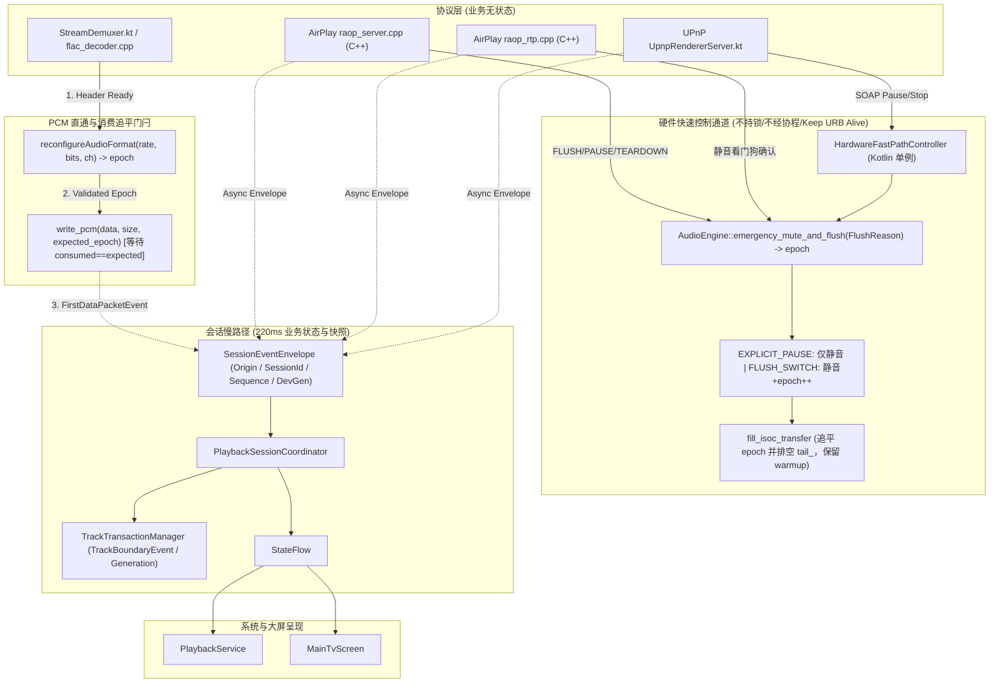

## Goal Capsule

- **Objective:** 彻底消除 PureCast 在 AirPlay 1 与 UPnP/DLNA 双协议推流播放时的切歌闪烁、误报 LIVE、暂停残音及画面抽动，建立高内聚、职责清晰的会话状态机，向 UI 和系统发射稳定的单一可信源快照。
- **Means:** 实施物理双通道分离（Native 与 `HardwareFastPathController` 统一调用 `emergencyMuteAndFlush()`，保持等时 URB 全 0 静音泵送以锁住 DAC 时钟；会话协调器处理 220ms 慢路径业务防抖）；引入无锁 `buffer_epoch_` 与双静音标识（显式暂停 vs 切歌预充自动 Unmute）保证 SPSC 并发安全与零吞音；通过 `SessionEventEnvelope`、`TrackBoundaryEvent` 与 UAC2 音频三元组切频落地全链路闭环。(KTD1, KTD2, KTD3, KTD5)
- **Authority Hierarchy:** 
  1. `播放器状态与底层推流解耦.md` 需求规格说明书
  2. 本规划文档的产品与技术契约（Product & Planning Contract）
  3. 各实施单元契约与执行规范（Implementation Units U0 ~ U7）
- **Stop Conditions:** 
  - U0 Native 原位切频与硬实时静音验证通过（实测 URB 切换全 0 静音帧 T3 $\le 20\text{ms}$，模拟残音消失 T4 $\le 50\text{ms}$，或确认安全回滚分支生效）；
  - 核心状态机与 Native CTest 单元测试通过，覆盖旧会话迟到丢弃、SPSC 消费端安全清游标、跨协议抢占、切歌防抖、DACP 串行排队与超时回退；
  - 达成全部 7 项真机端到端验收用例并留存完整 logcat 证据。
- **Execution Profile:** 生产级重构。先执行 U0 Native 验证，再推进 U1 模型与 U2 纯逻辑状态机，随后同步改造包含 C++ RAOP/FLAC 在内的协议层与硬件层，最后完成服务集成与 TV 界面对接。

---

## Product Contract

### Summary
本方案重构 PureCast 的播放会话控制体系，将 AirPlay 1 (RAOP) 与 UPnP/DLNA 协议服务端纯化为业务无状态事件生产者，统一汇入由 `PlaybackSessionCoordinator` 驱动的核心会话层。通过统一语义的硬件快路径 `emergencyMuteAndFlush()`（维持 URB 静音保活不丢失 DAC 时钟锁相）、无锁 Epoch 缓冲隔离、跨协议会话信封仲裁与 UAC2 三元组切频策略，提供广播级平滑稳定的电视大屏音频体验。

### Problem Frame
经过多轮架构与代码核验，当前系统及初版方案存在以下核心工程缺陷需要解决：
1. **快路径“停 URB”与“泵静音”自相矛盾**：现有 `audio_engine.cpp` 的 `pause_stream()` 本质是维持 8 个等时 URB 持续泵送全 0 静音保活帧（防止 Sony ZX300A/PHA-3 等外置 DAC 丢失 Explicit Feedback 时钟锁相或继电器爆音）。若在 `FLUSH/PAUSE` 时错误停撤 URB 将破坏时钟；
2. **SPSC 跨线程清零风险与“写先于清 (Write-Before-Clear)”吞首包漏洞**：现存 `flush_buffer()` 在非消费线程持有 `op_mutex_` 并调用 `ring_buffer_->clear()` 修改 `tail_`；而单纯让消费线程清缓冲又会在 `buffer_epoch_` 递增至下次 1ms URB 回调的窗口期内被生产者先写后清，吞掉新歌首帧，且不可误用受静音影响的 `is_streaming()` 判定消费者活跃性；
3. **`PAUSE` 与 `FLUSH_SWITCH` 语义混同及 `expected_epoch` 缺失传递链路**：UPnP 为连续 HTTP TCP 流，若暂停时递增 `buffer_epoch_` 并清空环形缓冲，会丢弃数百毫秒未播音频且使 `StreamDemuxer.kt` 持有的旧 epoch 在恢复后写入全被拒绝；同时 `is_paused()` 若计入切歌 Flush 标记会导致 `flac_decoder.cpp` 休眠死锁、无法触发 100ms 预充自动 unmute；
4. **热插拔非播放态污染与恢复缺口**：`IDLE`/`STOPPED` 下拔插 USB 若强制转入 `PAUSED` 会污染待机画面；授权后统一停留在 `RELEASED` 时，必须在 `StreamResumeEvent` 时对新 `fd` 先 `open_device`；
5. **切频抽象泄漏与宿主机编译障碍**：JNI 只应传递三元组 `(sampleRate, bitDepth, channels)` 并在切频后才写首帧 PCM；此外 `audio_engine.h` 直接 `#include <android/log.h>` 且测试清单误指非宿主机 `CMakeLists.txt`，会阻塞 macOS/Linux Host CTest 编译。

### Requirements

#### 架构边界与控制分流
- R1. **物理双通道与参数化快路径 (`emergencyMuteAndFlush(reason): Long`)**：
  - **硬件快路径 (Hardware Fast Path)**：Native RTSP/RTP 解码线程与 Kotlin 层 `HardwareFastPathController` 统一调用 `emergencyMuteAndFlush(reason): Long`（C++ 为 `FlushReason`）。该操作**不获取 `op_mutex_`、不停止 URB 提交、不经协程排队**，在 $\le 20\text{ms}$ (T3) 内使等时包输出全 0 静音帧，保证物理静音 T4 $\le 50\text{ms}$；仅在 10 秒空闲让渡、USB 拔出或失败回滚时才调用 `release_device()` 真正停撤 URB；
  - **按 `reason` 区分动作语义**：`EXPLICIT_PAUSE`（如 UPnP SOAP `Pause`）仅置 `is_explicitly_paused_ = true`，**不递增 `buffer_epoch_`、不清空 `SpscRingBuffer`**（保住未播音频并保持恢复后原 `expected_epoch` 有效）；`FLUSH_SWITCH` / `STOP_OR_TEARDOWN` / `PREEMPT` 才递增 `buffer_epoch_` 并触发消费端排空；
  - **数据平面直通、Epoch 获取与先切频后写首帧**：`reconfigureAudioFormat(...): Long` 与 `emergencyMuteAndFlush(...): Long` 返回最新 `epoch`（`>= 1L` 有效，`< 0L` 为错码），另提供 `getCurrentBufferEpoch(): Long`；PCM 直通 `write_pcm(data, size, expected_epoch)`，新流须先同步完成切频取到新 `epoch`，写入首帧 PCM 后再发射 `FirstDataPacketEvent`；
  - **会话状态慢路径 (Session State Path)**：协调器仅负责业务状态仲裁、元数据事务与 220ms 慢速防抖。
- R2. **SPSC 并发安全、“写先于清”同步门闩与双标志预充隔离**：
  - **消费端安全清缓冲与预充隔离**：严禁在 URB 消费线程活跃时从外部线程修改 `SpscRingBuffer::tail_`；消费线程检测 `consumed_epoch_ != buffer_epoch_` 后由自己清空 `tail_`、重置相位累加器与 `has_pre_rolled_ = false`，但**绝不重置 `warmup_packets_remaining_`**（URB 保活下继电器未断开，切歌不再多静音 50ms）；
  - **消除“写先于清”吞首包门闩**：`write_pcm(data, size, expected_epoch)` 当 `expected_epoch == buffer_epoch_` 但 `consumed_epoch_.load(acquire) != expected_epoch` 时：若 `is_running_.load(acquire) && active_transfers_.load(acquire) > 0`（严禁误用会因静音返回 `false` 的 `is_streaming()`！），生产线程让出微秒级等待（带超时与 `buffer_epoch_` 二次变更检查）直至消费线程追平 `consumed_epoch_` 再写首帧；仅当 `active_transfers_ == 0` 且在 `op_mutex_` 保护下，方允许生产侧/开流侧直接清空同步 `consumed_epoch_`；
  - **双标志与 `is_paused()` 语义隔离**：区分 **`is_explicitly_paused_`** 与 **`is_flushing_until_reroll_`**。`is_paused()` **仅反映 `is_explicitly_paused_`**（不含切歌 Flush），保证 `flac_decoder.cpp` 在暂停时正常挂起、切歌 Flush 时继续写入直到 100ms `has_pre_rolled_` 到位后在 Native 原位自动清除 `is_flushing_until_reroll_`。
- R3. **三态正交隔离与完整枚举**：
  - **传输管道态** (`TransportPipeState`)：`DISCONNECTED`, `PREPARING`, `STREAMING`, `INTERRUPTED`；
  - **硬件管道态** (`HardwarePipelineState`)：`DISCONNECTED`, `ATTACHED`, `PERMISSION_PENDING`, `RELEASED`, `EXCLUSIVE_MUTED`, `EXCLUSIVE_ACTIVE`, `AUDIO_RECONFIGURING`；
  - **业务会话态** (`BusinessSessionState`)：`IDLE`, `PLAYING`, `TRANSITIONING`, `PAUSED`, `STOPPED`；
  - **单一可信快照**：包含完整三态、`errors: Map<ErrorCode, PlaybackError>`，`playbackStatus` 严格由 `businessState` 纯函数单向映射。
- R4. **状态流转语义与超时闭环**：
  - 统一被动断流防抖为 **220ms**；区分 UI 切歌保护窗口（**800ms**）与 DACP 单项请求超时（**5000ms**）；
  - 补全 `HardwareIdleTimeoutEvent`（10 秒让渡 `STOPPED -> IDLE`）、`SuspendTimeoutEvent`（10 分钟待机）与 `RemoteCommandTimeoutEvent`（5 秒超时安全回退，防 UI 卡死在 `TRANSITIONING`）。

#### 跨协议事件、元数据与视觉保持
- R5. **跨协议信封与序号仲裁**：`SessionEventEnvelope` 携带 `EventOrigin(AIRPLAY, UPNP, USB_HARDWARE, SERVICE, USER_ACTION)`、`sessionId`、`deviceGeneration` 与单调 `sequence`。协调器丢弃旧会话与旧序号的状态事件。
- R6. **`TrackBoundaryEvent` 与曲目代数**：由协议层显式派发 `TrackBoundaryEvent(trackKey, trackGeneration)` 递增代数，旧代数分包一律丢弃。
- R7. **时长三态与寻道能力解耦**：废除 `isLiveStream`，全面采用 `DurationState(UNKNOWN, FIXED, LIVE)` 与 `SeekCapability(UNKNOWN, SEEKABLE, UNSEEKABLE)`。
- R8. **单一封面所有权与暗场保护**：模型层持真实封面（无置 null、防篡改字节拷贝），UI 层持视觉暂留 `persistentCover`（1200ms Crossfade）。

#### 硬件可靠性与遥控交互
- R9. **三元组 UAC2 切频与安全回滚**：对外 JNI 签名收敛为音频三元组 `reconfigureAudioFormat(sampleRate, bitDepth, channels): Long`，Native 内部通过 `parse_audio_descriptors` 匹配 `altSetting`；失败时返回负错误码并执行安全回滚（允许短暂可控静音重连），绝不死锁崩溃。
- R10. **USB 热插拔线程安全闭环与非播放态守卫**：广播接收器投递任务至单线程 `HardwareExecutor`；`HardwareDetachedEvent` 仅在 `PLAYING` / `TRANSITIONING` 时强制切入 `PAUSED` 并报错，**若原状态为 `IDLE` / `STOPPED` / `PAUSED` 则保持原业务态不变**；插回经 `ATTACHED -> PERMISSION_PENDING -> RELEASED`（已授权时直入 `RELEASED`，绝不提前空转 URB）；在 `RELEASED` 态收到 `StreamResumeEvent` 或 `StreamSetupEvent` 时须先对新 `fd` 调用 `open_device` 进入 `EXCLUSIVE_ACTIVE` 再恢复输出。
- R11. **TV 遥控器切歌队列与 UPnP 明确拦截**：AirPlay 采用**串行命令队列**执行连续按键；UPnP 接收端明确拦截不支持的遥控器切歌并弹出提示，不使用 GENA 伪造切歌。

### Scope Boundaries

#### In-Scope
- U0 Native 原子静音/Epoch/Write-Before-Clear 门闩/原位切频验证与独立 Host CTest (`app/src/main/cpp/tests/CMakeLists.txt`) 构建；
- `HardwareFastPathController` 与参数化 `emergencyMuteAndFlush(reason): Long` 全链路统一；
- 领域模型扩充（7 态硬件枚举、`FlushReason`、信封、错误集合、三态时长/寻道能力）；
- 协调器全量状态转换矩阵（含 10s 让渡、10m 挂起、5s 遥控超时回退、热插拔非播放态守卫与重开）；
- AirPlay C++ (`raop_server.cpp`, `raop_rtp.cpp`, `alac/alac_decoder.cpp`) 与 UPnP (`StreamDemuxer.kt`, `flac_decoder.cpp`) 无状态改造、`expectedEpoch` 传递与首帧精确通知；
- `UsbDeviceReceiver` 单线程安全热插拔闭环；
- `MainTvScreen` 与 `ProgressBarComponent` 对接。

#### Deferred to Follow-Up Work
- AirPlay 2 多房间时钟同步；
- UPnP Control Point 完整反向控制协议栈；
- 连续微秒级平滑 Scrubbing 寻道。

---

## Planning Contract

### Key Technical Decisions

- KTD1. **参数化快路径 `emergencyMuteAndFlush(reason): Long` 与 `PAUSE`/`FLUSH` 语义分化 (session-settled: user-directed — chosen over PAUSE/FLUSH 一刀切递增 epoch: 避免 UPnP HTTP 流暂停丢音与 epoch 失效)**
  - `EXCLUSIVE_MUTED` 状态下，**8 个等时 URB 与 4 个反馈 URB 保持连续运转**，填充全 0 静音帧锁定外部 DAC 物理时钟；仅在 `release_device()`（10s 空闲让渡、拔出、回滚重连）时停撤 URB；
  - `EXPLICIT_PAUSE`（如 UPnP SOAP `Pause`）：**仅置 `is_explicitly_paused_ = true` 切换全 0 保活，不递增 `buffer_epoch_`、不清空 `SpscRingBuffer`**；
  - `FLUSH_SWITCH` / `STOP_OR_TEARDOWN` / `PREEMPT`：置 `is_flushing_until_reroll_`（或静音）并递增 `buffer_epoch_.fetch_add(1)` 返回新 `epoch`；
  - Kotlin 层 UPnP Pause 经 `HardwareFastPathController.emergencyMuteAndFlush(EXPLICIT_PAUSE)` 直达 Native，Native RTSP/RTP 直接调用同类底层 C++ 方法。

- KTD2. **无锁 `buffer_epoch_`、“写先于清”同步门闩与预充隔离 (session-settled: user-directed — chosen over 仅校验 buffer_epoch_: 杜绝消费端清零抹掉已写首包)**
  - 消费线程（`fill_isoc_transfer`）检测 `consumed_epoch_ != buffer_epoch_` 时安全将 `tail_` 推进至 `head_`、重置相位累加器与 `has_pre_rolled_ = false`，**严禁重置 `warmup_packets_remaining_`**；
  - 生产端 `write_pcm(data, size, expected_epoch)` 在 `expected_epoch == buffer_epoch_` 但 `consumed_epoch_ != expected_epoch` 时启动同步门闩：当 `is_running_ && active_transfers_ > 0`（严禁用会因静音返回 `false` 的 `is_streaming()`!）等待消费线程 ≤1ms 追平后再写；当 `active_transfers_ == 0` 且持 `op_mutex_` 时直接清零同步；
  - 双静音标志职责：`is_paused()` **仅反映 `is_explicitly_paused_`**（避免 `flac_decoder.cpp` 在 `FLUSH_SWITCH` 期间误眠死锁）；当 `expected_epoch` 新数据到达 100ms `has_pre_rolled_` 水位且 `buffer_epoch_ == expected_epoch` 时 Native 原位自动清 `is_flushing_until_reroll_`；
  - **T1~T4 测量定义**：T3（URB 开始输出全 0 帧）$\le 20\text{ms}$；T4（DAC 模拟输出物理残音消失）$\le 50\text{ms}$。

- KTD3. **会话事件信封与完整超时闭环 (session-settled: user-directed — chosen over 缺失超时路径: 防止状态机永久僵死)**
  - `EventOrigin` 独立区分协议与硬件事件，硬件事件携带 `deviceGeneration`；
  - 明确区分 **800ms UI 切歌保护窗口**与 **5000ms DACP 单项请求超时**；新增 `RemoteCommandTimeoutEvent` 负责将卡在 `TRANSITIONING` 的状态回退还原，新增 `HardwareIdleTimeoutEvent` (10s) 与 `SuspendTimeoutEvent` (10m)。

- KTD4. **三元组 `reconfigureAudioFormat(...): Long` 封装 `altSetting` (session-settled: user-directed — chosen over 上层传入四元组: 符合硬件抽象边界)**
  - JNI 接口签名保留音频三元组 `(sampleRate, bitDepth, channels)` 并直接返回新激活的 `buffer_epoch_`（`Long`，负数为错误码）；
  - C++ 内部通过 `parse_audio_descriptors` 自主解析匹配的 `altSetting`、Data/Feedback Endpoint 和数据包尺寸；支持原地切频与安全回滚双轨制。

- KTD5. **先切频获取 Epoch 后写首帧 PCM 严密时序 (session-settled: user-approved — chosen over 异步并发切频: 消除高解析母带首包格式错位)**
  - 无论 WAV 还是 FLAC（`flac_decoder.cpp` 中 `on_format_ready` 返回 `int64_t expected_epoch`），解析出新流格式后，必须在写入第一块 PCM 之前同步完成切频校验获取最新 `expected_epoch`，再写入携该 `expected_epoch` 的 PCM 并在首包成功写入后触发 `FirstDataPacketEvent`。

### High-Level Technical Design

#### 1. 物理双通道与统一快路径架构


#### 2. 完整三态正交状态转换矩阵 (Tri-State Transition Matrix)

| 输入触发事件 | 传输管道态 (`transportState`) | 业务会话态 (`businessState`) | 硬件管道态 (`hardwareState`) | 派生展示态 (`playbackStatus`) | 核心动作与时序契约 |
| :--- | :--- | :--- | :--- | :--- | :--- |
| **新流初始化 (`StreamSetupEvent`)** | `PREPARING` | `TRANSITIONING` | 若 `RELEASED` 先 `open_device`，否则 `AUDIO_RECONFIGURING` | `PLAYING` | 抢占调用 `emergencyMuteAndFlush(PREEMPT)`；先三元组切频获新 `epoch` 后写首帧 |
| **首帧成功写入 (`FirstDataPacketEvent`)** | `STREAMING` | `PLAYING` | `EXCLUSIVE_ACTIVE` | `PLAYING` | Native 达 100ms 预充原位自动清 `is_flushing_until_reroll_`，启进度 |
| **切歌瞬态断流 (`TrackSwitchEvent / FLUSH`)** | `INTERRUPTED` | `TRANSITIONING` | `EXCLUSIVE_MUTED` | `PLAYING` | `emergencyMuteAndFlush(FLUSH_SWITCH)` `epoch++` 排空并保 URB 泵 0，UI 锁 220ms |
| **发送端显式暂停 (`ExplicitPauseEvent`)** | `INTERRUPTED` | 220ms 后切 `PAUSED` | `EXCLUSIVE_MUTED` | 220ms 后切 `PAUSED` | `emergencyMuteAndFlush(EXPLICIT_PAUSE)` **不动 `epoch` 与缓冲**，T3 $\le 20\text{ms}$ 保活 |
| **隐式静音确认 (`ImplicitPauseEvent`)** | `INTERRUPTED` | **0ms 立即切 `PAUSED`** | `EXCLUSIVE_MUTED` | `PAUSED` | 底层已确认静音保活，协调层 0ms 切换状态 |
| **点播正常播放完毕 (`TrackCompleteEvent / EOF`)** | `DISCONNECTED` | `STOPPED` | `EXCLUSIVE_MUTED` (待机) | `STOPPED` | 缓冲自然耗尽，启动 10 秒硬件空闲让渡计时器 |
| **10s 空闲让渡到期 (`HardwareIdleTimeoutEvent`)** | `DISCONNECTED` | `IDLE` | `RELEASED` | `IDLE` | 调用 `release_device()` 停撤 URB 并重绑内核驱动 |
| **10m 暂停挂起超时 (`SuspendTimeoutEvent`)** | `DISCONNECTED` | `IDLE` | `RELEASED` | `IDLE` | 彻底终止会话，释放声卡、DACP 凭据与低延迟锁 |
| **TV 遥控切歌 (`RemoteSkipNextEvent`)** | 保持现态 | `TRANSITIONING` | `EXCLUSIVE_MUTED` | `PLAYING` | 命令入串行队列，开 **800ms UI 保护**与 **5000ms 请求超时** |
| **5s 遥控切歌超时 (`RemoteCommandTimeoutEvent`)**| 保持现态 | 回退至触发前状态 (`PLAYING`/`PAUSED`) | 恢复或保持现态 | 回退态 | 发送端未响应切歌（如歌单末尾），防止 UI 永久卡死 |
| **流恢复播放 (`StreamResumeEvent`)** | `STREAMING` | `PLAYING`（硬件未就绪则阻断维持 `PAUSED`） | 若为 `RELEASED` 先对新 `fd` `open_device` $\to$ `EXCLUSIVE_ACTIVE` | `PLAYING` | 取消防抖/空闲倒计时，清 `is_explicitly_paused_` 沿用原 `epoch` 恢复输出 |
| **USB 物理拔出 (`HardwareDetachedEvent`)** | 保持现态 | 仅 `PLAYING`/`TRANSITIONING` **切 `PAUSED`**，其余**保持原态** | `DISCONNECTED` | 随 `businessState` | 单线程执行器置不可写、`release_device()` 停撤 URB 并注入硬件状态错误 |
| **USB 物理插回 (`HardwareAttachedEvent`)** | 保持现态 | **严格维持原业务态** (`IDLE`/`STOPPED`/`PAUSED`) | 有权限直转 `RELEASED`，否则 `ATTACHED`/`PERMISSION_PENDING` | 随 `businessState` | 检查系统 USB 授权，无权限停在 `PERMISSION_PENDING`，不提前空转 URB |
| **USB 授权通过 (`UsbPermissionGrantedEvent`)**| 保持现态 | **严格维持原业务态** (`IDLE`/`STOPPED`/`PAUSED`) | **`RELEASED`** | 随 `businessState` | 重扫就绪并定向清除断开错误，等待 `Resume/Setup` 按需 `open_device` |

---

## Implementation Units

### U0. 架构契约与 Native 并发/切频可行性验证 (Spike)
- **Goal:** 验证 Native 无锁 Epoch 静音、Write-Before-Clear 消费追平门闩与 `fill_isoc_transfer` 安全排空机制（实测 T3 $\le 20\text{ms}$、T4 $\le 50\text{ms}$），实现 Host CTest 独立编译并实测三元组 UAC2 原位切频与安全回滚。
- **Requirements:** R1, R2, R9
- **Dependencies:** 无
- **Files:**
  - `app/src/main/cpp/audio_engine.h`
  - `app/src/main/cpp/audio_engine.cpp`
  - `app/src/main/cpp/ring_buffer.h`
  - `app/src/main/cpp/jni_bridge.cpp`
  - `app/src/main/java/com/solo/purecast/core/nativebridge/NativeAudioEngine.kt`
  - `app/src/main/cpp/tests/CMakeLists.txt`
  - `app/src/main/cpp/tests/mocks/libusb.h`
  - `app/src/main/cpp/tests/audio_engine_test.cpp`
- **Approach:**
  1. 在 `audio_engine.h` 增加 `#ifdef __ANDROID__` 保护（非 Android 宿主机环境回退 `fprintf(stderr, ...)`），新建独立宿主机测试工程 `app/src/main/cpp/tests/CMakeLists.txt` 与轻量 `mocks/libusb.h` 桩，支持 macOS/Linux 直接编跑 CTest；
  2. 定义 `enum class FlushReason { EXPLICIT_PAUSE = 0, FLUSH_SWITCH = 1, STOP_OR_TEARDOWN = 2, PREEMPT = 3 }`，新增 `is_explicitly_paused_`、`is_flushing_until_reroll_`、`buffer_epoch_{1}` 与 `consumed_epoch_{1}`；
  3. 用无锁 `uint64_t emergency_mute_and_flush(FlushReason reason)` 替代旧 `flush_buffer()`：绝不获取 `op_mutex_`、绝不跨线程调用 `clear()`。其中 `EXPLICIT_PAUSE` **仅置 `is_explicitly_paused_ = true` 不递增 `buffer_epoch_`**；`FLUSH_SWITCH/STOP/PREEMPT` 才递增 `buffer_epoch_` 并返回新 epoch；`is_paused()` 严格仅返回 `is_explicitly_paused_.load()`；
  4. 消费端 `fill_isoc_transfer()` 在 `consumed_epoch_ != buffer_epoch_` 时由消费线程自己执行 `ring_buffer_->clear()`、重置相位累加器及 **`has_pre_rolled_ = false`（绝不重置 `warmup_packets_remaining_`）**，最后同步 `consumed_epoch_`；保持 8 个等时 URB 与 4 个反馈 URB 持续泵送全 0 静音包；
  5. 升级 `int write_pcm(const uint8_t* data, size_t size, uint64_t expected_epoch)`：
     - `expected_epoch != buffer_epoch_` 直接拒绝并返回负错码；
     - `consumed_epoch_ != expected_epoch` 时启动同步门闩：若 `is_running_ && active_transfers_ > 0`（严禁使用 `is_streaming()`！），短暂让出（带超时与 epoch 再次变动退出）等待消费端 ≤1ms 追平后再写；若 `active_transfers_ == 0` 则在 `op_mutex_` 下安全清空并追平；
     - 写入后达到 100ms 预充且 `buffer_epoch_ == expected_epoch` 时原位清 `is_flushing_until_reroll_`；
  6. 在 `NativeAudioEngine.kt` 与 `jni_bridge.cpp` 暴露 `emergencyMuteAndFlush(reason: Int): Long`、`reconfigureAudioFormat(sampleRate: Int, bitDepth: Int, channels: Int): Long`、`getCurrentBufferEpoch(): Long` 与 `writePcm(data: ByteArray, offset: Int, length: Int, expectedEpoch: Long): Int`；
  7. 在 `audio_engine.cpp` 实现三元组切频探针（内部通过 `parse_audio_descriptors` 自主匹配 `altSetting`）并实测 Sony ZX300A/PHA-3，验证失败安全回滚（释放后重走标准 `open_device`）。
- **Patterns to follow:** 严格遵守 SPSC 单生产者单消费者无锁铁律与 libusb URB 内存生命周期规则。
- **Test scenarios:**
  - **Write-Before-Clear 竞态测试**：快路径将 epoch 从 E1 推至 E2 后，生产线程在消费端尚未回调 `fill_isoc_transfer` 前立即调用 `write_pcm(new_hdr, size, E2)`；验证写门闩等待消费端先清完 E1 再写入 E2，新歌首帧字节 **100% 保留无一字节被抹除**；
  - **`EXPLICIT_PAUSE` 不丢缓冲测试**：写入 PCM 后触发 `emergency_mute_and_flush(EXPLICIT_PAUSE)`，验证 `buffer_epoch_` 不变、`ring_buffer_->available_read()` 不归零、`resume_stream()` 后仍可用原 epoch 无缝续写；
  - 多线程压力与 ASan/TSan 测试：生产线程高频写、控制线程随机 `FLUSH_SWITCH`/`EXPLICIT_PAUSE`、消费线程模拟读，验证 `tail_`/`head_` 不错乱、无死锁且 `warmup_packets_remaining_` 未被清歌逻辑意外重置；
  - 三元组切频与回滚测试：实测 44.1k $\to$ 96k $\to$ 192k 传流恢复；传入非法格式触发安全回滚且引擎可恢复。
- **Verification:** 宿主机 CTest 单元测试（含 ThreadSanitizer）全绿，真机示波/logcat 验证 T3 $\le 20\text{ms}$ 与切频/回滚行为达标。

---

### U1. 领域模型、7 态硬件枚举与信封契约
- **Goal:** 重构领域模型，补齐完整 7 态 `HardwarePipelineState` 枚举、会话信封、结构化错误集合及寻道/时长强类型。
- **Requirements:** R3, R5, R7
- **Dependencies:** U0
- **Files:**
  - `app/src/main/java/com/solo/purecast/model/PlaybackState.kt`
  - `app/src/main/java/com/solo/purecast/core/session/SessionEvents.kt`
  - `app/src/test/java/com/solo/purecast/model/PlaybackStateTest.kt`
- **Approach:**
  1. 补齐 `HardwarePipelineState`：`DISCONNECTED`, `ATTACHED`, `PERMISSION_PENDING`, `RELEASED`, `EXCLUSIVE_MUTED`, `EXCLUSIVE_ACTIVE`, `AUDIO_RECONFIGURING`；
  2. 扩展 `BusinessSessionState` 涵盖 `IDLE`, `PLAYING`, `TRANSITIONING`, `PAUSED`, `STOPPED`；并定义 `FlushReason(EXPLICIT_PAUSE, FLUSH_SWITCH, STOP_OR_TEARDOWN, PREEMPT)`；
  3. 声明 `EventOrigin`、`SessionEventEnvelope<T>(origin, sessionId, deviceGeneration, sequence, timestampElapsedMs, payload)`、`TrackBoundaryEvent` 与超时事件（`HardwareIdleTimeoutEvent`, `SuspendTimeoutEvent`, `RemoteCommandTimeoutEvent`）；
  4. 声明 `DurationState`、`SeekCapability` 与 `PlaybackError`；重构 `TrackMetadata` 移除 `isLiveStream`，增加 `trackUri` 与防御性 `coverBytes` 拷贝；
  5. 定义 `PlayerSessionSnapshot`，`playbackStatus` 严格纯函数映射自 `businessState`。
- **Patterns to follow:** 不可变数据类与 Sealed Interface。
- **Test scenarios:**
  - 全部 `BusinessSessionState` 到 `PlaybackStatus` 映射校验；
  - `HardwarePipelineState` 7 态覆盖测试；
  - `TrackMetadata` 防外部修改字节数组隔离测试。
- **Verification:** 单元测试通过，编译无警告。

---

### U2. 纯逻辑会话协调层与快速控制器实现
- **Goal:** 实现 `HardwareFastPathController` 单例、完整转换矩阵的 `PlaybackSessionCoordinator` 及基于 `TrackBoundaryEvent` 的 `TrackTransactionManager`。
- **Requirements:** R1, R3, R4, R5, R6, R8, R11
- **Dependencies:** U1
- **Files:**
  - `app/src/main/java/com/solo/purecast/core/session/HardwareFastPathController.kt`
  - `app/src/main/java/com/solo/purecast/core/session/PlaybackSessionCoordinator.kt`
  - `app/src/main/java/com/solo/purecast/core/session/TrackTransactionManager.kt`
  - `app/src/test/java/com/solo/purecast/core/session/PlaybackSessionCoordinatorTest.kt`
- **Approach:**
  1. `HardwareFastPathController`：封装对 `NativeAudioEngine.emergencyMuteAndFlush(reason): Long` 的同步快速调用（提供 `EXPLICIT_PAUSE` / `FLUSH_SWITCH` / `STOP_OR_TEARDOWN` / `PREEMPT` 区分，绝不经过协调器），UPnP SOAP `Pause`/`Stop` 直接调用；
  2. `TrackTransactionManager`：仅在收到 `TrackBoundaryEvent` 时自增 `trackGeneration`；元数据缺失包仅做增量修补绝不误增代数；旧代数分包一律丢弃；
  3. `PlaybackSessionCoordinator`：
     - 维护 `activeSessionId` 与 `lastAcceptedSequenceBySession` 过滤迟到/旧序号状态事件；
     - 全面实现 14 行三态正交转换矩阵（含 220ms 显式防抖、0ms 隐式切换、10s 空闲让渡、10m 挂起超时及非播放态热插拔守卫）；
     - 实现 DACP 串行命令队列（`Channel(UNLIMITED)` 依次派发，刷新 800ms UI 保护窗口，并对每条指令应用 5000ms 超时触发 `RemoteCommandTimeoutEvent` 安全回退）；
     - 维护 `errors: Map<ErrorCode, PlaybackError>` 错误集合。
- **Patterns to follow:** 纯逻辑 MVI 状态机，全部时间依赖通过注入 `TestDispatcher` / 虚拟时钟验证。
- **Test scenarios:**
  - 10s 空闲让渡测试：`STOPPED` 维持 10s 无新流自动触发 `HardwareIdleTimeoutEvent` 进 `IDLE` 并通知释放设备；
  - 5s 遥控切歌超时测试：模拟 `RemoteSkipNextEvent` 后发端无响应，5000ms 到期安全回退至 `PLAYING`/`PAUSED`，UI 不卡死；
  - 连按 3 次下一曲串行队列测试：验证 500ms 内 3 次点击顺序生成 3 条串行网络任务，而非合并丢弃；
  - 元数据缺失分包测试：Packet 1 仅歌名、Packet 2 仅歌手，验证在同一 `trackGeneration` 内正确合并且代数未发生错误自增。
- **Verification:** 行覆盖率 $\ge 90\%$，转换矩阵所有分支覆盖率 $100\%$。

---

### U3. 协议层（含 C++ RAOP/FLAC）彻底无状态改造
- **Goal:** 改造 AirPlay C++/Kotlin 与 UPnP/FLAC 底层代码，完全剥离对 `PlaybackService` 的反向依赖，落地精确的首帧写入通知与先切频后写帧顺序。
- **Requirements:** R1, R5, R6, R7, R11
- **Dependencies:** U0, U1, U2
- **Files:**
  - `app/src/main/cpp/raop/raop_server.h`
  - `app/src/main/cpp/raop/raop_server.cpp`
  - `app/src/main/cpp/raop/raop_rtp.h`
  - `app/src/main/cpp/raop/raop_rtp.cpp`
  - `app/src/main/cpp/alac/alac_decoder.h`
  - `app/src/main/cpp/alac/alac_decoder.cpp`
  - `app/src/main/cpp/flac_decoder.h`
  - `app/src/main/cpp/flac_decoder.cpp`
  - `app/src/main/cpp/jni_bridge.cpp`
  - `app/src/main/java/com/solo/purecast/airplay/AirPlayServerManager.kt`
  - `app/src/main/java/com/solo/purecast/airplay/AirPlayStateManager.kt`
  - `app/src/main/java/com/solo/purecast/upnp/UpnpRendererServer.kt`
  - `app/src/main/java/com/solo/purecast/upnp/StreamDemuxer.kt`
  - `app/src/test/java/com/solo/purecast/upnp/StreamDemuxerTransactionTest.kt`
- **Approach:**
  1. **AirPlay C++ `expected_epoch` 链路与快路径改造**：`raop_server.cpp` 在 `SETUP` 生成 Native 会话 UUID 并捕获取到的 `active_epoch_`；收到 `FLUSH` / `RECORD` 时调用 `AudioEngine::emergency_mute_and_flush(FLUSH_SWITCH)` 刷新 `active_epoch_`，收到 `PAUSE` 无 `FLUSH` 时调用 `emergency_mute_and_flush(EXPLICIT_PAUSE)`；`raop_rtp.cpp` 写入 `write_pcm(..., active_epoch_)`，并在新流首帧写入成功时发射 `FirstDataPacketEvent`；所有回调经 `jni_bridge.cpp` 携带 `sessionId` 与递增 `sequence` 异步上报；
  2. **UPnP WAV / FLAC `expectedEpoch` 串联与先切频后写首帧**：
     - FLAC 链路：修改 `flac_decoder.h/.cpp` 与 `jni_bridge.cpp`，让 `on_format_ready(...)` 同步回调返回 **`int64_t expected_epoch`**（由 `StreamDemuxer.kt` 完成 `reconfigureAudioFormat(...): Long` 后直接返回；若 `<= 0` 则立即退出解码）；`flac_decoder.cpp` 持有 `stream_epoch` 传入每次 `write_pcm(..., stream_epoch)`，且 `is_paused()` 仅在 `EXPLICIT_PAUSE` 时挂起，绝不阻塞 `FLUSH_SWITCH`；在首块 PCM 写入成功瞬时回调发射 `FirstDataPacketEvent`；
     - WAV 链路：`StreamDemuxer.kt` 在 `parseHeader` 后同步获取 `val expectedEpoch = reconfigureAudioFormat(...)`，校验 `> 0L` 后传入每次 `NativeAudioEngine.writePcm(pcmBuffer, offset, remaining, expectedEpoch)`，并于首块写入成功后发射 `FirstDataPacketEvent`；
  3. **协议层全面解耦**：彻底删除 `UpnpRendererServer` 与 `StreamDemuxer` 中持有的 `PlaybackService` 引用及直接修改 `_playbackStatus` 的代码，改为纯单向事件发送与只读状态查询接口；
  4. **UPnP 控制边界对齐**：UPnP SOAP `Pause` 立即调用 `HardwareFastPathController.emergencyMuteAndFlush(EXPLICIT_PAUSE)`（保留环形缓冲与当前 `expectedEpoch`，恢复时 `Play` 无缝续传）；UPnP SOAP `Stop` 调用 `emergencyMuteAndFlush(STOP_OR_TEARDOWN)`；TV 端遥控器切歌拦截并返回不支持提示，废除伪造 GENA `TRANSITIONING`。
- **Patterns to follow:** 单向事件流模式、JNI 线程安全局部引用管理。
- **Test scenarios:**
  - 先切频取 Epoch 后写帧顺序测试：模拟 44.1k 切 192k FLAC/WAV，验证在首块 PCM 写入 `writePcm(..., expectedEpoch)` 之前已同步获取新 `expectedEpoch`；
  - UPnP `Pause -> Play` 续播零丢音测试：验证 SOAP `Pause` 不递增 `epoch` 且后续恢复包写入全部放行、环形缓冲未丢失已解码音频；
  - 静态解耦校验：工程扫描确认协议类无任何 `PlaybackService` import 与引用；
  - UPnP 0x7FFFFFFF 无边界流测试：准确发射 `DurationState.LIVE` 与 `SeekCapability.UNSEEKABLE`。
- **Verification:** 协议层测试与 C++ 编译全绿。

---

### U4. 硬件层闭环、单线程热插拔与三元组切频落地
- **Goal:** 落地基于单线程 `HardwareExecutor` 的 USB 热插拔自愈闭环，实现 `IDLE`/`STOPPED` 非播放态隔离守卫、`ATTACHED -> PERMISSION_PENDING -> RELEASED` 统一落态、`StreamResumeEvent` 新 `fd` 重开恢复以及三元组切频回滚。
- **Requirements:** R3, R9, R10
- **Dependencies:** U0, U1, U2
- **Files:**
  - `app/src/main/java/com/solo/purecast/core/usb/UsbDeviceManager.kt`
  - `app/src/main/java/com/solo/purecast/core/usb/UsbDeviceReceiver.kt`
  - `app/src/main/java/com/solo/purecast/ui/MainActivity.kt`
- **Approach:**
  1. **线程安全热插拔**：`UsbDeviceReceiver.onReceive()` 严禁执行任何阻塞逻辑或直接停机 JNI，仅标记并将任务派发给专用的单线程 `HardwareExecutor`；
  2. **USB 拔出与非播放态守卫**：单线程执行器立即置 Native 不可写原子标记，调用 `release_device()` 撤回 URB 并销毁句柄，发射带独立 `deviceGeneration` 的 `HardwareDetachedEvent`（仅当 `businessState` 为 `PLAYING`/`TRANSITIONING` 时切 `PAUSED`；若为 `IDLE`/`STOPPED`/`PAUSED` 则严格保持原业务态不变）；
  3. **插回统一落态 `RELEASED` 与恢复自动重开新 `fd`**：收到插回事件进入 `ATTACHED`；校验 `usbManager.hasPermission()`，无权进 `PERMISSION_PENDING` 并发起 Activity 授权，已授权或 `UsbPermissionGrantedEvent` 通过后**统一进入 `RELEASED`**（不提前空转 URB），清除断开错误并维持原业务态不自动抢播；当随后收到 `StreamResumeEvent` 或 `StreamSetupEvent` 且检测到 `hardwareState == RELEASED` 时，**先对新 `fd` 执行 `open_device`（`claimUsbExclusive` $\to$ `EXCLUSIVE_ACTIVE`）** 再解除暂停恢复输出；
  4. **三元组切频对接**：`claimUsbExclusive(sampleRate, bitDepth, channels)` 遇到规格变更时优先调用 `NativeAudioEngine.reconfigureAudioFormat(sampleRate, bitDepth, channels): Long`（硬件进入 `AUDIO_RECONFIGURING`）并返回新 `epoch`；若返回负值则执行安全回滚（`releaseUsbExclusive` 后重开新规格）。
- **Patterns to follow:** 单线程执行器队列化处理硬件事件，杜绝 Android 广播线程超时 ANR 及多线程资源竞争。
- **Test scenarios:**
  - `IDLE`/`STOPPED` 下拔插 USB 防状态污染测试：验证处于主页 `IDLE` 或 `STOPPED` 时拔出/插回仅刷新 `hardwareState`，绝不将 `businessState` / `playbackStatus` 误改为 `PAUSED`；
  - `RELEASED` 授权后恢复重开测试：播放中拔出进 `PAUSED`，插回授权停在 `RELEASED`；随后触发 `StreamResumeEvent`，验证先对新 `fd` 调用 `open_device` 成功后再恢复为 `PLAYING`；
  - 热插拔未授权分支模拟：设备插回无权限时准确停留在 `PERMISSION_PENDING` 且不调用 `openDevice`；
  - 切频失败回滚测试：当 `reconfigureAudioFormat` 返回负值时，验证执行安全回滚重启且驱动不崩溃。
- **Verification:** 硬件管理层单元测试全部通过。

---

### U5. 前台服务系统集成与快照消费
- **Goal:** 重塑 `PlaybackService`，作为纯粹消费协调器快照与管理系统组件（MediaSession/Notification/Locks）的宿主服务。
- **Requirements:** R1, R3, R4, R7
- **Dependencies:** U2, U3, U4
- **Files:**
  - `app/src/main/java/com/solo/purecast/service/PlaybackService.kt`
  - `app/src/test/java/com/solo/purecast/service/PlaybackServiceIntegrationTest.kt`
- **Approach:**
  1. `PlaybackService` 创建并持有 `PlaybackSessionCoordinator` 及其依附于服务生命周期的 `CoroutineScope`；
  2. 订阅快照 `StateFlow`：
     - 同步 `MediaSession` 播放态与元数据；依据 `SeekCapability` 决定是否开放 `ACTION_SEEK_TO`；
     - 同步更新前台通知与全屏通知（BAL 保底）；
     - 依据 `businessState` 动态持有/释放低延迟 Wi-Fi 锁与 `WakeLock`。
- **Patterns to follow:** 单向数据流（UDF），服务本身不再包含任何状态机防抖或元数据处理分支。
- **Test scenarios:**
  - 快照订阅映射测试：验证协调器发出 `STOPPED` 与 `IDLE` 时系统 `MediaSession` 和锁定策略的精确同步；
  - 错误清除联动测试：设备恢复后通知栏及错误集合状态正确刷新。
- **Verification:** 服务集成测试通过。

---

### U6. Compose for TV 界面层平滑对接
- **Goal:** 大屏界面全面对接新快照（7 态硬件、结构化错误集合、强类型时长）及纯视觉暂留。
- **Requirements:** R3, R4, R7, R8, R10, R11
- **Dependencies:** U1, U2, U5
- **Files:**
  - `app/src/main/java/com/solo/purecast/ui/screen/MainTvScreen.kt`
  - `app/src/main/java/com/solo/purecast/ui/components/ProgressBarComponent.kt`
  - `app/src/main/java/com/solo/purecast/ui/components/PlaybackControls.kt`
  - `app/src/main/java/com/solo/purecast/ui/components/SignalPathPill.kt`
- **Approach:**
  1. `ProgressBarComponent` 仅消费 `DurationState` 与 `SeekCapability`：`UNKNOWN` 时 0% 归零显示 `--:--` 无红点；
  2. `MainTvScreen` 仅在 UI 视觉层维护 `persistentCover` 1200ms 过渡，模型层保持纯净；切歌 `TRANSITIONING` 时锁定流光与 `coverScale = 1.0f`；从 `errors` 集合中按优先级选取最严重错误展示；
  3. `SignalPathPill` 针对 `AUDIO_RECONFIGURING` 与 `PERMISSION_PENDING` 展示对应温和提示；
  4. `PlaybackControls` 在 UPnP 模式点击下一曲/上一曲弹出明确提示“请在投屏控制端操作切歌”，且全程不抢占遥控器当前焦点。
- **Patterns to follow:** 严格采用 `androidx.tv.material3` 与 D-Pad 焦点引擎规范。
- **Test scenarios:**
  - `DurationState.UNKNOWN` UI 组件渲染测试；
  - 模拟 `errors` 同时含网络和 USB 错误，验证优先呈现最高优先级硬件错误且插回后定向消失。
- **Verification:** Compose 单元测试与界面预览校验通过。

---

### U7. 自动化验证闭环与真机硬件实测
- **Goal:** 运行全部 Native CTest、覆盖率强制门限及 7 项真机物理端到端验收测试并收集日志。
- **Requirements:** 全部需求
- **Dependencies:** U0 ~ U6
- **Files:**
  - `app/src/test/java/com/solo/purecast/core/session/*`
  - `app/src/main/cpp/tests/*`
  - `app/src/androidTest/java/com/solo/purecast/*`
- **Approach:**
  1. 执行 CMake/CTest 验证 Native 无锁环形缓冲与原子静音并发正确性；
  2. 运行 Gradle Jacoco 覆盖率验证，未达标直接拦截；
  3. 按 `AGENTS.md` 真机测试规约，通过 ADB 隧道部署并接入 Sony USB DAC，使用真实 iPhone (AirPlay) 与 `test_upnp_push.py` (UPnP WAV/FLAC 高解析) 进行实机验收并记录完整日志。
- **Test scenarios:** 执行下方 Verification Contract 与 Definition of Done 中的所有测试矩阵。
- **Verification:** 全量自动化测试与 7 项真机测试全部实测通过并附有 logcat 证据。

---

## Verification Contract

### 自动化测试执行命令
```bash
# 1. 使用独立 Host 测试工程编译并运行 C++ Native CTest 测试套件 (macOS/Linux 宿主机直接编译，验证 Write-Before-Clear / PAUSE 保缓冲 / ASan/TSan)
cmake -S app/src/main/cpp/tests -B app/src/main/cpp/tests/build -DENABLE_SANITIZERS=ON && cmake --build app/src/main/cpp/tests/build && ctest --test-dir app/src/main/cpp/tests/build --output-on-failure

# 2. 运行纯逻辑状态机、领域模型与信封测试 (含虚拟时钟推进测试)
./gradlew testDebugUnitTest --tests "com.solo.purecast.core.session.*"
./gradlew testDebugUnitTest --tests "com.solo.purecast.model.*"

# 3. 运行协议无状态解耦与硬件管理器测试
./gradlew testDebugUnitTest --tests "com.solo.purecast.upnp.*"
./gradlew testDebugUnitTest --tests "com.solo.purecast.airplay.*"
./gradlew testDebugUnitTest --tests "com.solo.purecast.core.usb.*"

# 4. 执行全量测试与 JaCoCo 覆盖率强制门限检查
./gradlew jacocoTestCoverageVerification check

# 5. 构建真机调试 APK
./gradlew assembleDebug
```

### 质量门限指标
- 状态机与事务核心模块（`PlaybackSessionCoordinator` & `TrackTransactionManager`）指令行覆盖率 $\ge 90\%$，转换矩阵分支覆盖率 $100\%$（由 `jacocoTestCoverageVerification` 强校验）；
- CTest SPSC 并发压力测试必须 100% 通过且在 AddressSanitizer/ThreadSanitizer 下零竞争告警；
- 协议服务类（AirPlay/UPnP/Demuxer）零 `PlaybackService` 依赖引用。

---

## Definition of Done

1. **架构契约与代码规范**：
   - 彻底废除 `isLiveStream`，全量迁移至 `DurationState` 与 `SeekCapability`；
   - 协议层与硬件快路径彻底解耦，无阻塞持锁调用与跨线程 SPSC 破坏；
   - 完整中文注释与 `// 💡` 关键意图标识，零 TODO 代码。

2. **真机硬件验收测试矩阵（必须真机实测并留存 logcat 证据）**：
   - [ ] 验收用例 1：【AirPlay 切歌防 LIVE 闪烁验收】（切歌百毫秒无时长窗口内进度条为 0%、显示 `--:--`，无一帧红色 LIVE）；
   - [ ] 验收用例 2：【切歌零暂停抖动验收（AirPlay & UPnP）】（切歌全过程业务态恒为 `PLAYING`，封面不回缩抽动，按钮不闪现 `▶`）；
   - [ ] 验收用例 3：【切歌封面与背景防闪烁验收】（1200ms 视觉暂留与平滑 Crossfade，全屏流光暗化遮罩不闪白）；
   - [ ] 验收用例 4：【iPhone 端暂停极速响应验收】（显式信令硬件 T3 $\le 20\text{ms}$ 保持全 0 静音 URB 不丢锁相、T4 $\le 50\text{ms}$ 物理残音消失、UI 220ms 切换；隐式静音包断流 Native 确认后 UI 0ms 立即切换）；
   - [ ] 验收用例 5：【USB DAC 物理热插拔断开与自愈验收】（单线程安全停机、播放中拔出进 PAUSED 而 IDLE/STOPPED 保持不变；插回授权后统一停在 RELEASED 清除错误不抢播；触发恢复播放先重开新 `fd` 再正常出声）；
   - [ ] 验收用例 6：【UPnP 高解析度母带切频零闪变验收】（先切频后写首帧 PCM，44.1k $\to$ 96k/192k 原位重设时钟或安全回滚，声卡无死锁且信号胶囊无缝刷新）；
   - [ ] 验收用例 7：【遥控器连续快速切歌串行排队验收】（500ms 内连按 3 次下一曲，AirPlay 串行发送 DACP 命令并支持 5s 超时安全回退；UPnP 清晰展示不支持切歌拦截提示，焦点全过程稳定）。
