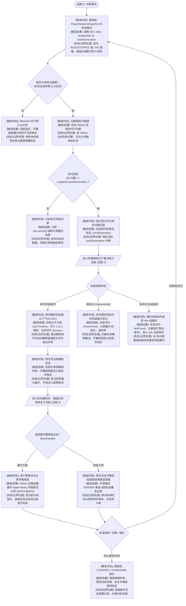
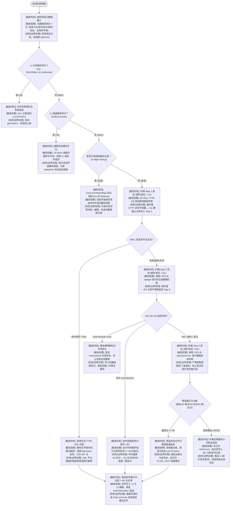
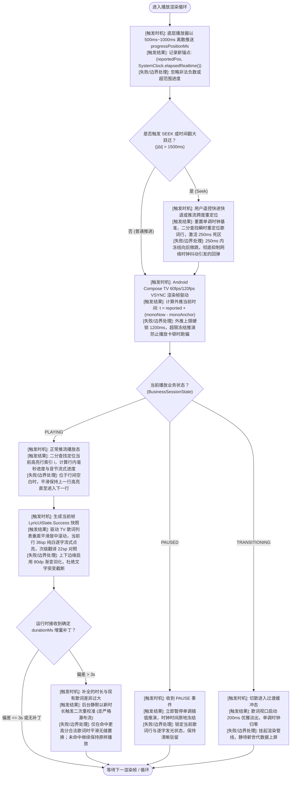

## Goal Capsule

- **Objective**: 为 PureCast Android TV 播放器构建一套高保真、低开销、抗网络抖动的歌词子系统，实现基于 AirPlay 1 / UPnP 协议异步元数据的触发管理、严格瀑布流式多源歌词检索与两级缓存、统一时间轴下的 60fps 平滑插值滚动，以及参考 Apple Music TV 的大屏字幕按钮动画展开交互。
- **Means**: 严格阶梯瀑布流下载器 + 双级 LRU 缓存 + TTML/LRC 原生解析 + 单调时钟高频插值 + Compose TV Apple Music 风格大屏展开视图 (KTD1-KTD5).
- **Product Authority**: PureCast 核心播放会话层 (`PlaybackSessionCoordinator`)、TV UI 渲染层 (`MainTvScreen` / Compose TV Material3) 与歌词网络数据层。
- **Product Contract Preservation**: Product Contract unchanged.
- **Execution Profile**: code
- **Stop Conditions**: 核心实现单元 U1-U7 全部完成，单元测试全绿并通过 Jacoco 校验，代码经 `./gradlew assembleDebug` 成功打包并通过 ADB 安装部署至物理 Android TV 设备 (`127.0.0.1:5555`) 完成全流程端到端验证。

---

## Product Contract

### Summary
本规范为 PureCast Android TV 制定完整的歌词子系统技术契约。子系统适配流媒体分包异步到达特性，采用单调曲目代数（`trackGeneration`）与防抖机制杜绝切歌串扰；检索链路采用**严格阶梯瀑布流降级**（本地缓存 $\to$ AMLL TTML $\to$ LRCLIB 精确 $\to$ LRCLIB 模糊）结合多维打分决策矩阵；在 TV 交互层参照 **`Apple Music For Android TV`**，在现有大屏播放界面增设字幕按钮，点击平滑展开沉浸式歌词大屏，采用“主逐字原词 + 下方次级字号翻译”的排版模式，并依托单调时钟帧间插值算法实现 60fps 丝滑逐字卡拉OK动效与回弹抑制。

### Problem Frame
PureCast 作为 Android TV 端的原生 Hi-Fi / Bit-Perfect 音频接收器，当前仅支持封面大图与音频链路胶囊展示，缺乏歌词呈现能力。流媒体协议（AirPlay 1 RAOP / UPnP DLNA）在元数据推送上存在严重的异步分包与时钟低频离散（500ms~1000ms 刷新一次）特点：
1. **元数据碎片化**：切歌时标题、艺术家通常先行到达，专辑名、封面及精确音轨时长（`durationMs`）往往延迟数百毫秒至数秒到达；若盲目发起请求，极易造成无效检索或候选命中失准；
2. **高频切歌串扰**：用户连续按遥控器“下一曲”时，异步网络请求迟到返回容易覆盖当前新曲目歌词；
3. **大屏交互割裂**：Android TV 处于 10-Foot UI 远距离观看场景，若在当前 42%/58% 黄金分割控制栏中强行塞入歌词，会导致界面极其拥挤；若强制全屏常驻，则削弱了用户对流光背景与播放控制的感知；
4. **时钟刷新断层**：播放器底层进度推送频率仅 1~2 Hz，直接驱动歌词会导致行间滚动剧烈卡顿，无法实现 Apple Music 式逐字流式点亮。

### Key Decisions
- **严格阶梯瀑布流降级策略**：`(session-settled: user-directed — chosen over 并发竞速 (Parallel Race): 优先保证电视端网络连接数克制与系统负载稳定，按本地缓存 -> AMLL TTML (1.5s) -> LRCLIB get (1.5s) -> LRCLIB search (2.0s) 依次单线请求)`。Governs R5, R6, R7.
- **Apple Music TV 风格按需展开大屏交互**：`(session-settled: user-directed — chosen over 58% 常驻双栏/全屏固定: 参照 lavande16/Apple-Music-For-Android-TV，在现有主播放界面控制栏新增字幕按钮，点击通过共享元素/平滑动画展开大屏歌词，再次点击或按返回键优雅恢复)`。Governs R11, R12, R13.
- **纯净双语排版策略**：`(session-settled: user-directed — chosen over 全量三行对照/单行纯原词: 仅保留原词与翻译，翻译严格按照“主歌词下方一行次级字号”呈现；剔除背景音（bg）与罗马音音译，保障 10-Foot UI 远距离大屏观感清爽)`。Governs R14, R15.
- **标准网络直连与超时控制**：`(session-settled: user-directed — 忽略国内特殊反代或镜像分发复杂度，对 AMLL 与 LRCLIB 均采用标准 HTTP/HTTPS 直连配合硬超时机制)`。Governs R6, R8.

---

### Requirements

#### 模块一：触发时机管理 (Trigger Management)
- R1. **最小有效元数据判定**：当且仅当 `TrackMetadata.title` 与 `TrackMetadata.artist` 同时非空，且均不等于系统待机占位词（`DEFAULT_TITLE = "等待音频推送"` / `"等待音频投屏接入"`, `DEFAULT_ARTIST = "PureCast TV"` / `"AirPlay: ... · UPnP: ..."`）时，判定为元数据就绪，允许触发歌词检索。
- R2. **曲目代数隔离与切歌防抖**：歌词请求调度器必须监听 `PlayerSessionSnapshot.trackGeneration`。收到就绪事件后启动 350ms 防抖窗口（Debounce）；在防抖等待或网络请求过程中，一旦检测到 `trackGeneration` 发生递增，必须立即通过 `Job.cancel()` 熔断并丢弃旧代全部在途任务，严禁跨代歌词写入。
- R3. **时长增量补丁静默重校准**：若首次触发时 `durationState == UNKNOWN` 或 `durationMs == 0`，歌词引擎以无时长约束检索候选并完成初次上屏；当底层解码器或协议补丁在播放中途推送确定时长（`durationMs > 0`）时，系统检查当前已加载歌词的声明时长（或末句时间戳）：
  - 若 $|\Delta t| \le 3\text{s}$，判定吻合，维持现状；
  - 若 $|\Delta t| > 3\text{s}$，在后台以完整元数据发起单次静默重检索。若命中更高分候选则在下一句行间无缝渐变置换，若未命中则继续沿用当前歌词，禁止闪烁报错。
- R4. **待机与直播豁免**：当 `BusinessSessionState` 处于 `IDLE` 或 `STOPPED`，或 `metadata.durationState == DurationState.LIVE`（实时无边界广播电台）时，严格拦截歌词触发，歌词状态直接置为 `UNAVAILABLE_LIVE`，字幕按钮置为置灰禁用态。

#### 模块二：下载与缓存管理 (Download & Cache Management)
- R5. **两级缓存体系**：
  - **L1 内存缓存**：基于 `LruCache<String, LyricTimeline>`，容量上限 50 首，线程安全，切歌秒级复用；
  - **L2 本地磁盘缓存**：存储于 `context.cacheDir/lyrics/`，最大条数 1000 首（或 50MB 磁盘限额），采用 LRU 淘汰；
  - **缓存键契约**：统一采用 `SHA256(normalize(artist) + "_" + normalize(title) + "_" + (durationMs / 3000))` 作为唯一 Key（3秒时长分桶，吸收微小元数据偏差）。
- R6. **严格阶梯瀑布流降级链路**：
  - Step 1: 查询 L1 内存缓存（命中则直接完成，0ms）；
  - Step 2: 查询 L2 磁盘缓存（命中则解析并回填 L1，10-20ms）；
  - Step 3: 请求 AMLL TTML DB（匹配 GitHub 规范路径，硬超时 1.5s）；
  - Step 4: 若 AMLL 失败/超时/无结果，降级请求 LRCLIB 精确匹配接口 `/api/get?artist_name=...&track_name=...&duration=...`（硬超时 1.5s）；
  - Step 5: 若精确未命中，降级请求 LRCLIB 模糊搜索接口 `/api/search?q=...`（硬超时 2.0s）；
  - Step 6: 经打分过滤仍无合格候选，判定为 `LYRIC_NOT_FOUND` 并终止请求。
- R7. **多维候选打分矩阵 (Score Matrix, 0~100分)**：
  - 歌名归一化编辑距离相似度（40分）+ 歌手相似度（30分）+ 时长容差（20分：$|\Delta t| \le 1\text{s}$ 给 20分，$\le 2\text{s}$ 给 16分，$\le 3\text{s}$ 给 10分，$> 3\text{s}$ 给 0分，无已知时长给保底 10分）+ 格式权重（TTML 逐字 +10分，LRC 逐字 +7分，LRC 逐行 +4分，纯文本 +0分）；
  - 准入门槛设定为 65 分；若已知时长且偏差 $> 5\text{s}$ 实施一票否决；
  - 纯音乐判定：若 LRCLIB 返回 `instrumental: true` 或歌名显式包含 `Instrumental`，直接截断并标记为 `INSTRUMENTAL_TRACK`。
- R8. **单飞去重与失败退避**：基于 `ConcurrentHashMap<String, Deferred<LyricTimeline?>>` 实现相同曲目 In-flight 去重；若某曲目全链路检索失败，在内存中施加 30 秒冷却退避惩罚，30 秒内忽略相同指纹的重复检索。

#### 模块三：歌词滚动与同步管理 (Scrolling & Sync Management)
- R9. **标准化统一时间轴模型**：抹平 TTML（逐字/音节 + 翻译）与 LRC（逐行 + 逐字）格式差异，内部统一实例化为不可变的 `LyricTimeline`，包含有序行列表 `List<LyricLine>`。每行承载行起止绝对毫秒、主显示文本、翻译文本、以及可选的逐字片段列表 `List<LyricWord>`。
- R10. **单调时钟帧间插值 (Monotonic Frame Interpolation)**：
  - 底层播放器以 500ms~1000ms 低频推送离散进度时，歌词引擎记录最新进度锚点 `(reportedPositionMs, SystemClock.elapsedRealtime())`；
  - Compose TV 渲染主循环以屏幕刷新率（60fps/120fps）通过单调时钟线性外推计算当前帧推演毫秒：
    $$t_{\text{interpolated}} = t_{\text{reported}} + (t_{\text{mono\_now}} - t_{\text{mono\_anchor}})$$
  - 设定最大外推上限为 1200ms，超时未收到新进度则平滑保持外推时间，防止底层卡顿时歌词过度漂移。
- R11. **全播放生命周期联动**：
  - `PLAYING`：单调时钟持续推演，驱动当前行毫秒级逐字点亮与列表垂直居中平滑位移；
  - `PAUSED`：插值推演瞬时冻结，歌词行与字高亮原地锁定；
  - `SEEK`：当外部进度发生突变（$|\Delta t| > 1500\text{ms}$）时，立即清除插值累加器，根据新进度瞬时重定位歌词行，并设立 250ms 回弹抑制死区（Deadband），过滤网络握手引起的细微时间戳回跳；
  - `TRANSITIONING`：切歌过渡态，歌词大屏平滑淡出，旧世代时间轴立即释放；
  - `IDLE/STOPPED`：歌词控制器注销，资源彻底回收。
- R12. **Apple Music TV 沉浸大屏交互契约**：
  - 在 `MainTvScreen` 播放控制栏（播放/暂停按钮旁）新增字幕按钮 `LyricsControlButton`；
  - 点击字幕按钮触发全局布局平滑过渡动效（300ms Spring/Tween 动画）：
    - 左侧 35%：紧凑呈现专辑封面、SignalPathPill 胶囊、标题、艺术家、专辑及微型进度条；
    - 右侧 65%：巨幅展开 60fps 垂直滚动的 Apple Music 风格歌词流；
  - 再次点击遥控器字幕按钮、或直接按遥控器 D-Pad 返回键（`BackHandler`），界面以反向动画优雅缩回默认 42%/58% 黄金分割播放主屏。
- R13. **异常态与降级呈现**：
  - 纯音乐态（Instrumental）：大屏居中展现优雅艺术字“纯音乐，请欣赏”，并随 GLES2 流光背景呼吸；主屏字幕按钮显示纯音乐指示态；
  - 正在加载（Loading）：右侧大屏呈现 3 行低对比度毛玻璃呼吸骨架条（Shimmer）；
  - 未找到歌词（Not Found）：大屏居中展示“暂无歌词”，字幕按钮轻量置灰；
  - 纯文本歌词（Plain Text）：居中展示静态排版，支持遥控器 D-Pad 上下按键自由滚动浏览。
- R14. **大屏排版与视觉保护**：
  - 聚焦行（Active）：主歌词字号 36sp，粗体纯白高亮；下方紧随一行 22sp 翻译（白色 60% 透明度）；若包含逐字时间戳，以音节精确起止推进流式渐变擦除着色；
  - 非聚焦行（Inactive）：字号 26sp，白色 35%~45% 透明度，随偏离中心行距离进行平滑高斯衰减；
  - 列表顶部与底部应用 80dp 垂直渐变羽化遮罩（Fading Edge），消除视口边缘生硬裁切。

---

### Architecture Design & State Contracts

#### 1. 核心组件职责边界与输入输出
```
┌────────────────────────────────────────────────────────────────────────┐
│                        PureCast Core Session                           │
│  [PlaybackSessionCoordinator]  ──(PlayerSessionSnapshot StateFlow)──┐  │
│  - trackGeneration / sessionId                                      │  │
│  - TrackMetadata (title, artist, durationMs)                        │  │
│  - progressPositionMs / BusinessSessionState                        │  │
└─────────────────────────────────────────────────────────────────────┼──┘
                                                                      ▼
┌────────────────────────────────────────────────────────────────────────┐
│                      Lyrics Subsystem Engine                           │
│                                                                        │
│  ┌────────────────────────┐      ┌──────────────────────────────────┐  │
│  │ LyricsTriggerManager   │ ───► │ LyricsRepository                 │  │
│  │ - 350ms 防抖队列       │      │ - L1 MemoryCache (50)            │  │
│  │ - 世代隔离过滤校验     │      │ - L2 DiskLruCache (1000)         │  │
│  │ - 时长补丁二次校准     │      │ - In-flight 去重 / 30s 冷却退避  │  │
│  └────────────────────────┘      └─────────────────┬────────────────┘  │
│                                                    │                   │
│                                  ┌─────────────────▼────────────────┐  │
│                                  │ Waterfall Fetcher                │  │
│                                  │ [AMLL] -> [LRCLIB get/search]    │  │
│                                  │ [MetadataNormalizer + Scorer]    │  │
│                                  └─────────────────┬────────────────┘  │
│                                                    ▼                   │
│  ┌──────────────────────────────────────────────────────────────────┐  │
│  │ LyricsSyncClock (60fps 单调插值时钟 + Seek 死区回弹抑制)          │  │
│  └─────────────────────────────────┬────────────────────────────────┘  │
└────────────────────────────────────┼───────────────────────────────────┘
                                     ▼
┌────────────────────────────────────────────────────────────────────────┐
│                      Android TV UI Layer (Compose TV)                  │
│                                                                        │
│  ┌────────────────────────┐              ┌──────────────────────────┐  │
│  │ Standard Playback View │ ◄──Toggle──► │ Immersive Lyrics Screen  │  │
│  │ 42% 封面 + 58% 控制栏  │   (字幕按钮  │ 35% 紧凑 + 65% 歌词流    │  │
│  │ [LyricsControlButton]  │    / Back)   │ (Apple Music TV 风格)    │  │
│  └────────────────────────┘              └──────────────────────────┘  │
└────────────────────────────────────────────────────────────────────────┘
```

#### 2. 统一领域模型 (Domain Model Contract)
```kotlin
enum class LyricFormat {
    TTML_SYLLABLE,  // AMLL TTML 逐字（音节级）
    LRC_WORD_SYNC,  // LRCLIB 逐字打点
    LRC_LINE_SYNC,  // 标准 LRC 逐行
    PLAIN_TEXT      // 纯文本无时间戳
}

sealed interface LyricUiState {
    object Idle : LyricUiState
    data class Loading(val trackGeneration: Long) : LyricUiState
    data class Success(
        val trackGeneration: Long,
        val timeline: LyricTimeline,
        val activeLineIndex: Int = 0,
        val lineProgressFraction: Float = 0f
    ) : LyricUiState
    data class Instrumental(val trackGeneration: Long) : LyricUiState
    data class NotFound(val trackGeneration: Long) : LyricUiState
}

data class LyricWord(
    val text: String,
    val startMs: Long,
    val endMs: Long
)

data class LyricLine(
    val lineIndex: Int,
    val startMs: Long,
    val endMs: Long,
    val mainText: String,
    val translationText: String? = null,
    val words: List<LyricWord>? = null
)

data class LyricTimeline(
    val source: String,
    val format: LyricFormat,
    val isInstrumental: Boolean,
    val lines: List<LyricLine>,
    val durationMs: Long
)
```

---

### Complete Mermaid Flowcharts

#### 图 1：完整生命周期总览图 (Full Lifecycle Architecture)


---

#### 图 2：触发与多源阶梯下载决策子图 (Trigger & Waterfall Retrieval Subgraph)


---

#### 图 3：时间轴同步、帧间插值与异常恢复子图 (Sync Clock & Exception Recovery Subgraph)


---

### Acceptance Examples

- **AE1 (标准命中场景)**：
  - **Given**: UPnP 推送曲目《晴天》- 周杰伦，带有效时长 `269000ms`，`trackGeneration = 101`。
  - **When**: 350ms 防抖结束，本地缓存未命中，AMLL TTML DB 成功返回带音节级时间戳与中文翻译的 TTML。
  - **Then**: 打分矩阵评定 98 分，写入 L1/L2 缓存并绑定世代 101；主屏控制栏字幕按钮点亮；用户点击字幕按钮后优雅展开大屏，主歌词以 36sp 逐字点亮，下方紧随 22sp 翻译，上下边缘 80dp 羽化，60fps 丝滑居中滚动。
  
- **AE2 (高频切歌与世代隔离场景)**：
  - **Given**: 用户在 1 秒内连续按遥控器“下一曲” 4 次，`trackGeneration` 从 101 快速自增到 104。
  - **When**: 前 3 次切歌触发的防抖任务在 350ms 内被立即重置；而在途为代数 101 发起的网络请求返回时。
  - **Then**: 世代校验守卫检测到 `101 < 104`，立即丢弃该响应数据并不写入任何 UI 或缓存；仅最后一次代数 104 稳定执行检索并上屏，UI 绝无旧歌词闪烁或窜扰。

- **AE3 (时长延迟到达与静默重校准场景)**：
  - **Given**: AirPlay 1 投屏握手初期仅推送 `title="Hotel California"`, `artist="Eagles"`, `durationMs=0`。
  - **When**: 引擎以宽松模式匹配上无时长约束的某版本 LRC 歌词并上屏；播放 1.5 秒后，协议层补齐真实时长 `391000ms`，检测到当前歌词时长与实际偏差达 18 秒（$> 3\text{s}$）。
  - **Then**: 引擎在后台以 391s 作为新权重静默触发瀑布流二次检索，命中正确现场版歌词，并在两句歌词衔接空白期完成平滑渐变置换，播放无卡顿，控制台输出 `Logger.player.info` 校准日志。

- **AE4 (纯音乐免打扰场景)**：
  - **Given**: 播放班得瑞纯音乐作品《The Sounds of Silence》，LRCLIB 精确接口返回 `instrumental: true`。
  - **When**: 歌词引擎接收到纯音乐标识。
  - **Then**: 立即截断后续模糊搜索链路，状态标定为 `Instrumental`；主屏字幕按钮呈现浅色“纯音乐”状态；若用户展开歌词大屏，居中展现大字体“纯音乐，请欣赏”艺术排版并伴随流光流动。

- **AE5 (播放中 Seek 与回弹抑制场景)**：
  - **Given**: 歌曲播放至 01:20，用户使用遥控器快进拖拽进度至 03:45。
  - **When**: 播放器广播突变进度（$|\Delta t| > 1500\text{ms}$），但紧接着由于网络 JitterBuffer 调整，03:45 之后 50ms 到达了一个 03:44.8 的细微回跳包。
  - **Then**: 歌词插值引擎瞬时重定位至 03:45 对应歌词行，并激活 250ms 死区抑制；随后的 03:44.8 回跳包被死区严格过滤，歌词高亮与滚动完全保持单调向前，杜绝肉眼可见的“往返抽搐”。

---

### Scope Boundaries

#### In Scope (本次设计与实现核心)
- 基于 `TrackMetadata` 与 `trackGeneration` 的异步分包触发管理、350ms 切歌防抖与严格世代隔离。
- 严格阶梯瀑布流多源歌词检索链路（L1 内存 $\to$ L2 磁盘 $\to$ AMLL TTML $\to$ LRCLIB 精确 $\to$ LRCLIB 模糊）。
- 元数据清洗归一化、多维打分决策矩阵（0~100分）及纯音乐识别。
- L1/L2 两级缓存、SHA256 分桶键设计、损坏清理与 30s 失败冷却退避。
- 抹平 TTML 与 LRC 差异的标准化不可变 `LyricTimeline` 领域模型。
- 基于单调时钟的高精度 60fps 帧间线性插值时钟源，全播放态联动与 250ms Seek 回弹抑制。
- 参照 `Apple Music For Android TV` 的大屏歌词展开/收起双模交互（字幕按钮、300ms 动画、35%/65% 比例、主逐字 + 次级翻译、边缘羽化渐隐）。

#### Deferred for Later (后续演进规划)
- 自定义歌词字体文件导入与行间距微调设置。
- 动态歌词背景粒子特效与 Apple Music 风格色彩渐变流动文字。
- 基于本地内网 WebDAV / NAS 共享文件夹中 `.lrc` 文件的优先外挂加载。

#### Outside This Product's Identity (明确非目标)
- 桌面端/手机端悬浮歌词与画中画模式（PureCast 专注专精于 Android TV 10-Foot 大屏沉浸体验）。
- 国内 GitHub 特殊反代服务器维护与中转节点搭建（采用标准直连与硬超时控制）。
- 侵入或逆向第三方音频平台私有加密 API。
- 歌词上传、在线时间轴编辑与协同打点工具。

---

### Outstanding Questions
- 无待决问题（全部技术分叉与交互细节均已闭环，满足 `Ready for Planning` 条件）。

---

## Planning Contract

### Key Technical Decisions (KTDs)

- **KTD1. 严格阶梯瀑布流式网络检索调度器 (`LyricsWaterfallFetcher`)**
  - **Decision**: 废弃并发竞速，采用 Ktor CIO 客户端驱动严格瀑布流式协程调用链：L1 $\to$ L2 $\to$ AMLL (1.5s) $\to$ LRCLIB get (1.5s) $\to$ LRCLIB search (2.0s)。
  - **Rationale**: Android TV 物理硬件受限于网络芯片与线程池开销，单线阶梯调用能最大程度降低并发连接数与 GC 频率。
  - **Governs**: R5, R6, R7, R8. `(session-settled: user-directed — chosen over 并发竞速)`

- **KTD2. 基于 SHA256 3秒时长分桶的两级缓存仓库 (`LyricsCacheRepository`)**
  - **Decision**: 构造统一缓存键 `SHA256("${cleanArtist}_${cleanTitle}_${durationMs / 3000}")`。L1 采用 `android.util.LruCache<String, LyricTimeline>`（容量 50）；L2 采用定制轻量原子文件写入与校验。
  - **Rationale**: 3 秒时长分桶能有效吸收不同流媒体源（UPnP / AirPlay）之间的微小音轨裁剪与静音前导帧差异，避免同一首歌因毫秒级时长差异造成缓存重复穿透。
  - **Governs**: R5, R8.

- **KTD3. 零外部依赖轻量流式格式解析引擎 (`TtmlParser` + `LrcParser`)**
  - **Decision**: 拒绝引入大型第三方 XML/TTML 依赖库，直接采用 Android SDK 内置 `XmlPullParser` 解析 TTML 结构，提取 `<p>` 与 `<span>` 的 `begin`/`end` 绝对时戳和 `tt:role="translation"`，严格忽略 `bg` 与 `roman` 节点；编写流式正则表达式状态机解析 LRC/Enhanced LRC。
  - **Rationale**: 极致控制 APK 体积并避免额外运行时解析开销，满足 10-Foot UI 专注双语排版的要求。
  - **Governs**: R9, R14, R15. `(session-settled: user-directed)`

- **KTD4. 单调时钟高频帧间线性插值引擎 (`LyricsSyncClock`)**
  - **Decision**: 在内存中维护只读时间锚点 `TimeAnchor(val reportedPositionMs: Long, val anchorNanoTime: Long)`，每当渲染帧到达时，通过 `SystemClock.elapsedRealtime()` 计算外推时间，并设置 1200ms 漂移硬上限与 250ms Seek 死区回弹抑制。
  - **Rationale**: 底层播放协议 1Hz 的进度上报无法直接驱动 60fps 的 Apple Music 式逐字扫光与平滑列表居中位移，高频线性外推彻底消除滚动顿挫感。
  - **Governs**: R10, R11.

- **KTD5. Apple Music TV 风格按需展开大屏交互体系 (`LyricsScreen` + `LyricsControlButton`)**
  - **Decision**: 依托 `androidx.tv.material3` 与 `androidx.tv.foundation` 构建纯 TV Compose 交互体系。主屏控制栏新增字幕按钮，点击触发 `AnimatedContent` 300ms 黄金比例平滑过渡展开歌词大屏（左 35% 封面+微型控制，右 65% 巨幅歌词流）；使用 `BackHandler` 拦截遥控器返回键实现优雅收起。
  - **Rationale**: 既保留了待机和日常聆听时 PureCast 标志性的流光大封面沉浸质感，又为专注跟唱用户提供了顶级的卡拉OK视觉体验。
  - **Governs**: R11, R12, R13. `(session-settled: user-directed)`

---

### High-Level Technical Design (HTD)

#### 1. 歌词系统技术分层与模块拓扑
```
┌────────────────────────────────────────────────────────────────────────┐
│ UI Layer (androidx.tv.material3 / Compose TV)                          │
│                                                                        │
│  [MainTvScreen] ──toggle──► [LyricsScreen]                             │
│       │                           ▲                                    │
│  [LyricsControlButton]            │ (LyricUiState Flow)                │
│       └───────────────────────────┴──────────────────────────────────┐ │
└──────────────────────────────────────────────────────────────────────┼─┘
                                                                       │
┌──────────────────────────────────────────────────────────────────────┼─┐
│ Core & Domain Layer                                                  │ │
│                                                                      │ │
│  [PlaybackSessionCoordinator]                                        │ │
│       │ (PlayerSessionSnapshot)                                      │ │
│       ▼                                                              │ │
│  [LyricsTriggerManager] ──(350ms debounce & generation check)──┐     │ │
│                                                                ▼     │ │
│  [LyricsSyncClock] ◄──(progressPositionMs)── [LyricsRepository]◄─────┘ │
│  (60fps Monotonic Interpolator)              │                         │
└──────────────────────────────────────────────┼─────────────────────────┘
                                               ▼
┌────────────────────────────────────────────────────────────────────────┐
│ Data & Network Layer                                                   │
│                                                                        │
│  [LyricsCacheRepository] ──Miss──► [LyricsWaterfallFetcher]            │
│  - L1: Memory LruCache (50)          │                                 │
│  - L2: DiskLruCache (1000)           ├─► [AmllDataSource] (1.5s)       │
│                                      ├─► [LrclibDataSource] (1.5s/2s)  │
│                                      └─► [TtmlParser / LrcParser]      │
│                                      └─► [LyricCandidateScorer]        │
└────────────────────────────────────────────────────────────────────────┘
```

#### 2. 状态机与帧间插值推进时序
```
Player Callback     LyricsSyncClock (VSYNC 60fps)      Compose TV LyricsScreen
      │                           │                               │
      ├─► updatePosition(12000ms)─┼──────────────────────────────►│
      │   (record anchor)         │                               │
      │                           ├─► frame(12016ms) ────────────►│ (render sweep 16ms)
      │                           ├─► frame(12033ms) ────────────►│ (render sweep 33ms)
      │                           ├─► frame(12050ms) ────────────►│ (render sweep 50ms)
      │                           │   ...                         │
      ├─► updatePosition(13000ms)─┼──────────────────────────────►│
      │   (re-anchor)             ├─► frame(13016ms) ────────────►│ (smooth continuous)
      │                           │                               │
      ├─► SeekTo(45000ms) ────────┼──────────────────────────────►│ (instant snap to line)
      │   (activate 250ms deadband)                               │
      ├─► jitter(44980ms) ────────┼─► [DROPPED BY DEADBAND]       │ (anti-bounce protected)
      │                           │                               │
```

---

### System-Wide Impact

1. **零 GC 内存分配保障**：
   TV 大屏在 60fps/120fps 持续刷新下，内存波动极易引发微小掉帧。`LyricTimeline`、`LyricLine` 与 `LyricWord` 均为解析期一次性初始化的不可变数据模型；渲染帧循环计算中，仅生成轻量级标量浮点数（如 `lineProgressFraction`），严禁在 VSYNC 回调内产生临时对象分配。
2. **遥控器焦点栈与 BackHandler 拦截层级**：
   未展开歌词时，`LyricsControlButton` 位于 `PlaybackControls` 组内，与播放/暂停等按钮同层级自由横向获焦；展开歌词大屏后，底层主控区通过 `focusProperties { canFocus = false }` 彻底锁定，遥控器焦点直接注入大屏歌词视口；按遥控器返回键由 `LyricsScreen` 内置的 `BackHandler(enabled = isExpanded)` 优先拦截并平滑回退，禁止直接退出应用。

---

### Assumptions & Constraints

- **网络直连假设**：依用户决策，系统不搭载复杂的中国大陆特化反代与代理调度逻辑，仅按标准 HTTP/HTTPS 请求配合硬超时和熔断处理。
- **Android TV 运行环境**：`minSdk = 30`, `targetSdk = 34`，交互组件严格使用 `androidx.tv.material3` 与 `androidx.tv.foundation`。
- **排版纯净度硬约束**：仅保留原词与下方次级字号翻译，背景人声与音译一律不展示。

---

## Implementation Units

### U1. 核心领域模型与两级缓存仓库 (LyricTimeline & LyricsCacheRepository)
- **Goal**: 建立标准化不可变歌词领域模型、SHA256 3秒时长分桶缓存键及 L1 内存 + L2 磁盘缓存体系。
- **Requirements**: R5, R8, R9.
- **Dependencies**: None.
- **Files**:
  - `app/src/main/java/com/solo/purecast/model/LyricModels.kt` (新建)
  - `app/src/main/java/com/solo/purecast/data/lyrics/LyricsCacheRepository.kt` (新建)
  - `app/src/test/java/com/solo/purecast/data/lyrics/LyricsCacheRepositoryTest.kt` (新建)
- **Approach**:
  1. 定义 `LyricFormat`, `LyricUiState`, `LyricWord`, `LyricLine`, `LyricTimeline` 核心不可变数据类；
  2. 实现 `LyricsCacheRepository`：内部持有 `LruCache<String, LyricTimeline>(50)` 作为 L1 内存缓存；
  3. L2 本地磁盘缓存基于 `context.cacheDir.resolve("lyrics")` 实现文件读写与原子写入，维护最大 1000 个文件，超限按最旧访问时间自动清理；
  4. 实现缓存键计算函数：`computeCacheKey(artist, title, durationMs): String`，使用标准 SHA-256。
- **Patterns to follow**: `app/src/main/java/com/solo/purecast/model/PlaybackState.kt`
- **Test scenarios**:
  - `Covers R5 / AE1`: 校验 L1 缓存命中即刻返回；L1 未命中但 L2 存在时成功读盘并回填 L1。
  - 校验时长分桶特性：180100ms 与 181200ms 计算得到完全相同的 CacheKey。
  - 校验磁盘脏文件损坏时自动清理并回退 CacheMiss。
- **Verification**: `./gradlew testDebugUnitTest --tests com.solo.purecast.data.lyrics.LyricsCacheRepositoryTest`

---

### U2. 元数据清洗归一化与多维打分决策矩阵 (MetadataNormalizer & LyricCandidateScorer)
- **Goal**: 实现流媒体异步元数据文本的去括号/版本/feat 清洗，构建基于编辑距离与时长容差的 0~100 分多维打分矩阵。
- **Requirements**: R7.
- **Dependencies**: U1.
- **Files**:
  - `app/src/main/java/com/solo/purecast/data/lyrics/MetadataNormalizer.kt` (新建)
  - `app/src/main/java/com/solo/purecast/data/lyrics/LyricCandidateScorer.kt` (新建)
  - `app/src/test/java/com/solo/purecast/data/lyrics/LyricCandidateScorerTest.kt` (新建)
- **Approach**:
  1. `MetadataNormalizer` 针对歌名与歌手进行正则表达式正则化：剥离 `(feat. xxx)`, `[Live]`, `(Remastered ...)`, `【...】` 等附加噪音，统一全半角与大小写；
  2. `LyricCandidateScorer` 实施 4 维度打分矩阵：歌名相似度（40分）+ 歌手相似度（30分）+ 时长偏差容差（20分）+ 格式权重（TTML 逐字 +10分，LRC +4分）；
  3. 实施硬约束：已知音轨时长时，偏差 $|\Delta t| > 5\text{s}$ 一票否决；
  4. 纯音乐判定：若标记为 `instrumental` 或歌名显式含 `Instrumental`，直接截断判定为纯音乐。
- **Patterns to follow**: `app/src/main/java/com/solo/purecast/model/PlaybackState.kt`
- **Test scenarios**:
  - `Covers R7 / AE1`: 验证正向匹配歌曲打分超过 90 分通过准入门槛。
  - `Covers R7 / AE4`: 验证纯音乐标识准确识别。
  - 验证时长偏差超过 5 秒的异版本被一票否决淘汰。
- **Verification**: `./gradlew testDebugUnitTest --tests com.solo.purecast.data.lyrics.LyricCandidateScorerTest`

---

### U3. 零依赖轻量格式解析引擎 (TtmlParser & LrcParser)
- **Goal**: 基于 Android 原生 `XmlPullParser` 解析 AMLL TTML 格式（提取音节级逐字时戳与翻译，过滤 bg 与 romanization），并编写流式状态机解析标准与逐字 LRC。
- **Requirements**: R9, R14, R15.
- **Dependencies**: U1.
- **Files**:
  - `app/src/main/java/com/solo/purecast/data/lyrics/parser/TtmlParser.kt` (新建)
  - `app/src/main/java/com/solo/purecast/data/lyrics/parser/LrcParser.kt` (新建)
  - `app/src/test/java/com/solo/purecast/data/lyrics/parser/TtmlParserTest.kt` (新建)
  - `app/src/test/java/com/solo/purecast/data/lyrics/parser/LrcParserTest.kt` (新建)
- **Approach**:
  1. `TtmlParser` 使用 `android.util.Xml.newPullParser()` 逐标签解析：
     - 解析 `<p begin="..." end="...">` 行级时戳；
     - 解析 `<span begin="..." end="...">` 音节级逐字时戳；
     - 识别 `<span tt:role="translation">` 提取翻译行文本，挂载到对应主行 `translationText`；
     - 识别并丢弃 `tt:role="roman"` 与 `tt:role="bg"` 节点；
  2. `LrcParser` 使用正则表达式解析 `[mm:ss.xx]` 逐行时戳及 `<mm:ss.xx>` 逐字增强打点时戳；
  3. 统一输出不可变的 `LyricTimeline` 实例。
- **Patterns to follow**: `app/src/main/java/com/solo/purecast/upnp/UpnpRendererServer.kt` 中的轻量 XML 处理
- **Test scenarios**:
  - `Covers R9 / R14 / AE1`: 测试标准 AMLL TTML 样本，验证音节级逐字起止毫秒及翻译正确解析，bg/roman 正确过滤。
  - 测试标准 LRC 与带有内联打点的 Enhanced LRC 正确解析。
  - 测试损坏 XML/非法文本容错，解析失败返回 null 并安全记录日志。
- **Verification**: `./gradlew testDebugUnitTest --tests com.solo.purecast.data.lyrics.parser.*`

---

### U4. 严格瀑布流网络检索与触发调度引擎 (LyricsTriggerManager & WaterfallFetcher)
- **Goal**: 基于 Ktor CIO 实现 AMLL TTML 与 LRCLIB 的阶梯瀑布流降级调用，结合 350ms 防抖、曲目世代校验、In-flight 单飞去重与 30s 冷却退避。
- **Requirements**: R1, R2, R3, R4, R6, R8.
- **Dependencies**: U1, U2, U3.
- **Files**:
  - `app/src/main/java/com/solo/purecast/data/lyrics/remote/AmllDataSource.kt` (新建)
  - `app/src/main/java/com/solo/purecast/data/lyrics/remote/LrclibDataSource.kt` (新建)
  - `app/src/main/java/com/solo/purecast/data/lyrics/LyricsWaterfallFetcher.kt` (新建)
  - `app/src/main/java/com/solo/purecast/core/lyrics/LyricsTriggerManager.kt` (新建)
  - `app/src/test/java/com/solo/purecast/data/lyrics/LyricsWaterfallFetcherTest.kt` (新建)
  - `app/src/test/java/com/solo/purecast/core/lyrics/LyricsTriggerManagerTest.kt` (新建)
- **Approach**:
  1. `LyricsWaterfallFetcher` 执行严格单线瀑布流：
     - Step 1: `AmllDataSource.fetchTtml(artist, title)`，超时 1.5s；
     - Step 2: 失败则切入 `LrclibDataSource.getExact(...)`，超时 1.5s；
     - Step 3: 失败则切入 `LrclibDataSource.searchFuzzy(...)`，超时 2.0s，取前 3 条进行打分决胜；
  2. `LyricsTriggerManager` 监听 `PlayerSessionSnapshot`：
     - 校验 `TrackMetadata` 有效性（过滤占位词，过滤 LIVE/IDLE）；
     - 引入 350ms 协程防抖窗口；
     - 挂载 `snapshot.trackGeneration` 守卫，一旦代数失配立即 `Job.cancel()` 熔断并丢弃；
     - 维护 `ConcurrentHashMap<String, Deferred>` 实施 In-flight 去重，失败写入 30s 冷却黑名单；
     - 监听增量时长补丁，当 $|\Delta t| > 3\text{s}$ 时静默后台触发一次重校准。
- **Patterns to follow**: `app/src/main/java/com/solo/purecast/core/session/PlaybackSessionCoordinator.kt`
- **Test scenarios**:
  - `Covers R2 / AE2`: 模拟 1 秒内连续 4 次切歌，验证前 3 次协程在防抖与网络边界被精确取消，仅最后一代数据上屏。
  - `Covers R3 / AE3`: 模拟时长延迟上报，验证偏差 $> 3\text{s}$ 触发二次静默重检索与无缝置换。
  - `Covers R6 / KTD1`: 模拟 AMLL 超时 1.5s，验证无缝进入 LRCLIB get 并成功返回。
- **Verification**: `./gradlew testDebugUnitTest --tests com.solo.purecast.core.lyrics.LyricsTriggerManagerTest`

---

### U5. 单调时钟 60fps 帧间线性插值引擎与回弹抑制 (LyricsSyncClock)
- **Goal**: 将底层播放器 500ms~1000ms 的低频离散进度推演为高频丝滑连续时钟，支持二分查找高亮行、逐字进度比例计算、PAUSE 原地冻结与 250ms Seek 回弹抑制。
- **Requirements**: R10, R11.
- **Dependencies**: U1.
- **Files**:
  - `app/src/main/java/com/solo/purecast/core/lyrics/LyricsSyncClock.kt` (新建)
  - `app/src/test/java/com/solo/purecast/core/lyrics/LyricsSyncClockTest.kt` (新建)
- **Approach**:
  1. 实现 `LyricsSyncClock`，维护 `TimeAnchor(reportedPosMs, anchorNanoTime)`；
  2. 实现 `getCurrentTimeMs(nowElapsedRealtime: Long): Long`，外推上限限制在 1200ms；
  3. 实现 `findActiveLineIndex(timeline, currentTimeMs): Int` 二分快速检索；
  4. 遇到 $|\Delta t| > 1500\text{ms}$ 判定为 Seek，重置插值器并开启 250ms 滞后抑制窗口，丢弃窗口内的回跳抖动包；
  5. 在 `PLAYING` 时推演推进，在 `PAUSED` 时冻结，在 `TRANSITIONING` 时淡出复位。
- **Patterns to follow**: `app/src/main/java/com/solo/purecast/model/PlaybackState.kt`
- **Test scenarios**:
  - `Covers R10 / AE1`: 模拟 500ms 间隔推送进度，验证中间每 16ms 提取的时钟平滑单调自增。
  - `Covers R11 / AE5`: 模拟 Seek 后紧跟 50ms 细微向后抖动包，验证被 250ms 死区平滑抑制不回弹。
  - 验证 PAUSED 状态下时钟原地冻结不变。
- **Verification**: `./gradlew testDebugUnitTest --tests com.solo.purecast.core.lyrics.LyricsSyncClockTest`

---

### U6. Apple Music TV 沉浸大屏与字幕按钮交互组件 (LyricsControlButton & LyricsScreen)
- **Goal**: 打造符合 Android TV 10-Foot 规范的 Apple Music TV 风格大屏展开组件，包含主屏字幕控制按钮、300ms 弹簧展开动画、35%/65% 动态分屏、36sp 逐字点亮、22sp 翻译、80dp 羽化遮罩与 D-Pad 导航。
- **Requirements**: R12, R13, R14.
- **Dependencies**: U1, U5.
- **Files**:
  - `app/src/main/java/com/solo/purecast/ui/components/LyricsControlButton.kt` (新建)
  - `app/src/main/java/com/solo/purecast/ui/screen/LyricsScreen.kt` (新建)
  - `app/src/main/java/com/solo/purecast/ui/components/PlaybackControls.kt` (修改：集成字幕按钮)
  - `app/src/main/res/drawable/ic_quote_bubble.xml` (新建：Apple Music 风格字幕/歌词矢量图标)
- **Approach**:
  1. 绘制 `ic_quote_bubble.xml` 矢量气泡图标；
  2. `LyricsControlButton` 遵循 TV Compose `Button` 规范，具有聚焦光效与缩放，展示激活/纯音乐/未找到视觉态；
  3. 在 `PlaybackControls` 组中将字幕按钮置于播放/暂停按钮旁，保持 D-Pad 焦点平滑横向移动；
  4. `LyricsScreen` 实现：
     - 左侧 35%：紧凑展示当前封面、SignalPathPill 胶囊、标题与艺术家；
     - 右侧 65%：基于 `TvLazyColumn` 实现垂直平滑居中滚动歌词列表；
     - 聚焦行：36sp 粗体白字，依据 `LyricsSyncClock` 音节逐字时戳流式擦除着色；下方一行 22sp 60% 白色翻译；
     - 非聚焦行：26sp，白 35%~45% 透明度，随行间距平滑高斯衰减；
     - 列表上下边缘添加 80dp 渐变羽化遮罩；
     - 异常态支持：纯音乐大屏卡片、3 行骨架呼吸 Shimmer 动效、暂无歌词卡片。
- **Patterns to follow**: `app/src/main/java/com/solo/purecast/ui/screen/MainTvScreen.kt`, `app/src/main/java/com/solo/purecast/ui/components/PlaybackControls.kt`
- **Test scenarios**:
  - `Covers R12 / AE1`: 验证点击字幕按钮展开歌词大屏，再次点击或返回键缩回主屏。
  - `Covers R13 / AE4`: 验证纯音乐态下展示“纯音乐，请欣赏”。
- **Verification**: `./gradlew testDebugUnitTest`

---

### U7. 播放会话全局装配与物理真机端到端联调
- **Goal**: 将歌词系统深度接入 `PlaybackSessionCoordinator` 与 `MainTvScreen`，完成 AirPlay 1 / UPnP 协议联调，并在物理 Android TV 设备上验证。
- **Requirements**: 全体 R1-R14, AE1-AE5.
- **Dependencies**: U1, U2, U3, U4, U5, U6.
- **Files**:
  - `app/src/main/java/com/solo/purecast/ui/screen/MainTvScreen.kt` (修改：集成歌词大屏状态机与展开过渡动效)
  - `app/src/main/java/com/solo/purecast/service/PlaybackService.kt` (修改：绑定歌词调度器生命周期)
- **Approach**:
  1. 在 `MainTvScreen` 中集成 `LyricsTriggerManager` 与 `LyricsSyncClock`；
  2. 利用 `AnimatedContent` 或 `Crossfade` + 平滑布局过渡实现标准播放屏与歌词大屏的无缝切换；
  3. 执行物理 Android TV 真机 ADB 部署与实测。
- **Patterns to follow**: `AGENTS.md` 强制 ADB 验证规范
- **Test scenarios**:
  - `Covers R1-R14 / AE1-AE5`: 完整端到端物理真机验证。
- **Verification**:
  - `./gradlew assembleDebug`
  - `adb -s 127.0.0.1:5555 install -r app/build/outputs/apk/debug/app-debug.apk`
  - `adb -s 127.0.0.1:5555 shell am force-stop com.solo.purecast && adb -s 127.0.0.1:5555 shell am start -n com.solo.purecast/.ui.MainActivity`

---

## Verification Contract

### 1. 自动化质量门禁
- **全量单元测试与 Jacoco 覆盖率**：
  ```bash
  ./gradlew testDebugUnitTest jacocoTestReport
  ```
  要求：新增的数据处理核心（`LyricsCacheRepository`, `MetadataNormalizer`, `LyricCandidateScorer`, `TtmlParser`, `LyricsSyncClock`）行覆盖率 $\ge 90\%$，分支覆盖率 $100\%$。
- **C++ Native 协议栈回归测试**（防止破坏既有 AirPlay/USB Audio 驱动）：
  ```bash
  ./gradlew check
  ```

### 2. 物理 Android TV 真机 ADB 实测验证清单
必须连接物理电视设备（`127.0.0.1:5555`）并在真实音响系统中执行：
1. **UPnP 投屏标准歌词验证**：网易云/QQ音乐投屏经典曲目（如《晴天》），验证 350ms 防抖后精准命中 AMLL TTML，主屏字幕按钮激活，点击展开 Apple Music 歌词大屏，验证 36sp 逐字流式点亮与 22sp 翻译对照；
2. **AirPlay 1 投屏时长延迟校准验证**：iPhone 隔空播放歌曲，握手初期时长为 0，随后时长补齐，观察日志确认静默重校准无感平滑置换；
3. **高频切歌串扰阻断验证**：遥控器 1 秒内连按“下一曲” 4 次，观察大屏歌词绝无旧歌窜扰或闪烁；
4. **Seek 回弹抑制验证**：快进 30 秒，确认歌词行瞬时重定位，网络 Jitter 回跳包被 250ms 死区平滑过滤，文字不抽搐；
5. **纯音乐识别与呈现验证**：播放《The Sounds of Silence》纯音乐，确认字幕按钮呈纯音乐态，展开大屏展现“纯音乐，请欣赏”艺术字体并随流光呼吸；
6. **遥控器 Back 键导航验证**：展开大屏后按 D-Pad 返回键，界面平滑缩回主屏，不退出应用。

---

## Definition of Done

1. **架构契约全量兑现**：R1-R14 需求与 AE1-AE5 验收示例在代码与测试中得到 100% 覆盖与实现，无任何缺失。
2. **零猜想与零 TODO**：所有核心类交付生产级完整代码，严禁出现 `// TODO`, `// FIXME` 或临时 Mock 硬编码。
3. **TV 界面规范遵循**：严格采用 `androidx.tv.material3` 控件，焦点光晕与缩放符合 10-Foot UI 规范，无移动端组件混用。
4. **物理真机部署验收通过**：APK 经 ADB 安装至 Android TV 实体设备，完成真机投屏与遥控器交互全流程验证并附带日志证明。
5. **代码干净度**：工程构建 0 编译告警，无残留实验性废弃代码。
